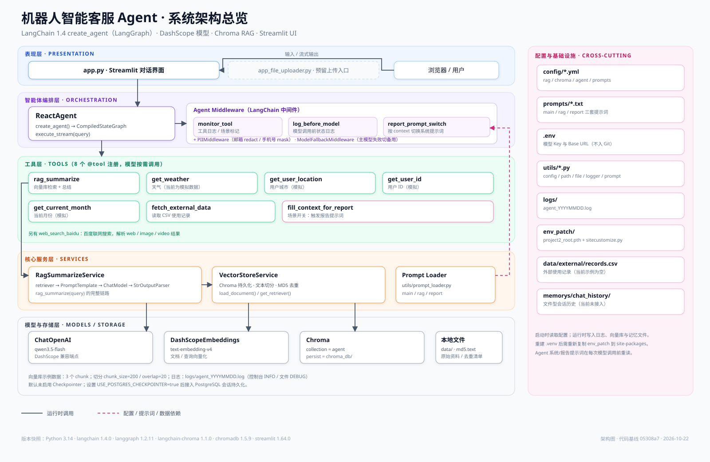

# 机器人智能客服 Agent

基于 **LangChain 1.x `create_agent`（LangGraph）** 构建的工具调用型智能客服原型：支持 RAG 知识问答、业务数据查询、报告场景提示词切换，以及 Streamlit 对话界面。

> 这是一份面向开发者的项目入口文档。5 分钟速览见 [docs/PROJECT_OVERVIEW.md](docs/PROJECT_OVERVIEW.md)；深入原理、配置项、扩展步骤与技术债见 [docs/ARCHITECTURE.md](docs/ARCHITECTURE.md)。

---

## 导读

**先选一条路线**

| 目标 | 建议阅读 | 时间 |
| --- | --- | --- |
| 5 分钟知道项目是什么 | 本文第 1–2 节 + [1 页速览](docs/PROJECT_OVERVIEW.md) | 5 分钟 |
| 把项目跑起来 | 本文第 4 节 + 第 7 节 | 15 分钟 |
| 改代码/加功能 | [ARCHITECTURE](docs/ARCHITECTURE.md) 第 5、6、13 节 | 30–60 分钟 |
| 排障/上线 | [ARCHITECTURE](docs/ARCHITECTURE.md) 第 10、11、12 节 | 按需 |

**文档地图**

| 文件 | 用途 |
| --- | --- |
| [README.md](README.md) | 当前文件：门面、上手指南、命令与配置速查 |
| [docs/PROJECT_OVERVIEW.md](docs/PROJECT_OVERVIEW.md) | 1 页速览，人和 AI 的快速入口 |
| [docs/ARCHITECTURE.md](docs/ARCHITECTURE.md) | 当前状态的深度参考：模块、流程、配置、扩展、技术债 |
| [docs/architecture.svg](docs/architecture.svg) | 分层架构图（人看） |
| [docs/rag-pipeline.svg](docs/rag-pipeline.svg) | RAG 数据流图（人看） |
| [AGENTS.md](AGENTS.md) | AI 阅读约定（可选，供编码助手使用） |
| [CHANGELOG.md](CHANGELOG.md) | 重要变更日志（Keep a Changelog 格式，未发布改动在 `[Unreleased]`） |

**本文目录**

1. [项目定位](#1-项目定位)
2. [能力清单](#2-能力清单)
3. [技术栈](#3-技术栈)
4. [快速开始](#4-快速开始)
5. [目录结构](#5-目录结构)
6. [代码阅读路线](#6-代码阅读路线)
7. [配置入口速查](#7-配置入口速查)
8. [已知限制](#8-已知限制)
9. [文档索引](#9-文档索引)
10. [安全与协作约定](#10-安全与协作约定)

---

## 1. 项目定位

| 维度 | 说明 |
| --- | --- |
| 业务形态 | 机器人/设备智能客服：回答知识库问题，按需查询用户、城市、月份、使用记录，并生成报告 |
| 技术形态 | 单进程 Streamlit 应用 + LangGraph Agent + Chroma 本地向量库 |
| 适用范围 | 原型验证、LangChain Agent 学习、二次开发脚手架 |
| 非目标 | 生产级多租户、鉴权、计费、高可用；当前均未实现 |

**一句话架构**：Streamlit 收集问题 → `ReactAgent` 调用 `create_agent` 构建 LangGraph → 模型在中间件约束下循环调用工具 → RAG/CSV/模拟工具返回结果 → 模型生成答案 → 按消息块流式返回页面。



---

## 2. 能力清单

| 能力 | 状态 | 实现位置 |
| --- | --- | --- |
| 多轮工具调用（ReAct 循环） | ✅ 已接入 | `agent/react_agent.py` → `create_agent` |
| RAG 知识库问答 | ✅ 已接入 | `rag/rag_service.py` + `rag/vector_store.py` |
| 工具调用日志 | ✅ 已接入 | `agent/tools/middleware.py` → `monitor_tool` |
| 模型调用前状态日志 | ✅ 已接入 | `agent/tools/middleware.py` → `log_before_model` |
| 报告场景动态提示词 | ✅ 已接入 | `fill_context_for_report` + `report_prompt_switch` |
| 联网搜索（百度） | ✅ 已接入 | `agent/tools/agent_tools.py` → `web_search_baidu` |
| PII 脱敏（邮箱/手机号） | ✅ 已接入 | `agent/tools/middleware.py` → `PIIMiddleware` |
| 模型降级（主模型 → 备用模型） | ✅ 已接入 | `agent/tools/middleware.py` → `ModelFallbackMiddleware` |
| 外部使用记录查询 | 🧪 示例 | `fetch_external_data` 读取 CSV，示例文件当前为空 |
| 天气 / 城市 / 用户 ID / 月份 | 🧪 模拟 | `agent/tools/agent_tools.py` 中返回随机或固定值 |
| 会话记忆（短期 / 本地 JSON / PostgreSQL） | ✅ 已接入 | `app.py` 输入框左侧按钮切换；`memorys/memory_factory.py`、`file_checkpointer.py`、`postgres_checkpointer.py` |
| 文件上传入库 | 🧪 预留 | `app_file_uploader.py` 当前为空壳 |
| 鉴权 / 多用户 / 限流 | ❌ 未实现 | — |

---

## 3. 技术栈

| 层 | 组件 | 版本 | 作用 |
| --- | --- | --- | --- |
| 运行时 | CPython | 3.14（`pyproject` 要求 ≥3.13） | 由 uv 管理的项目虚拟环境 |
| 包管理 | uv | 0.12.9 | 依赖安装、锁文件、命令执行 |
| Agent 框架 | langchain | 1.4.0 | `create_agent`、中间件、工具装饰器 |
| 图执行 | langgraph | 1.2.11 | Agent 的 StateGraph 运行时、`stream` |
| 状态持久化 | langgraph-checkpoint-postgres / psycopg | 3.2.0 / 3.3.6 | PostgreSQL checkpointer 与连接池 |
| 模型接入 | langchain / langchain-openai | 1.4.0 / 1.6.6 | `init_chat_model` 构造官方 `ChatOpenAI`，调用 DashScope OpenAI 兼容端点 |
| 社区集成 | langchain-community | 0.4.2 | `DashScopeEmbeddings`、PDF/TXT Loader |
| 向量库 | langchain-chroma / chromadb | 1.1.0 / 1.5.9 | 本地持久化向量检索 |
| 文本切分 | langchain-text-splitters | 1.1.2 | `RecursiveCharacterTextSplitter` |
| 模型服务 | dashscope | 1.27.5 | 通义千问/Embedding SDK |
| UI | streamlit | 1.64.0 | 对话界面与流式渲染 |
| 文档解析 | pypdf | 6.18.1 | PDF 文本提取 |
| 配置 | PyYAML / python-dotenv | 6.0.3 / 1.2.3 | YAML 配置、`.env` 加载 |
| HTTP 客户端 | requests | 2.34.2 | 百度联网搜索 |

模型：`qwen3.5-flash`（对话，经 DashScope OpenAI 兼容模式）；`text-embedding-v4`（向量化）；`glm-5`（备用对话模型，主模型失败时自动降级）。

---

## 4. 快速开始

### 4.1 前置条件

- Windows / macOS / Linux
- 已安装 [uv](https://docs.astral.sh/uv/)
- 一个可用的 DashScope API Key

### 4.2 安装依赖

在项目根目录执行：

```powershell
uv sync
```

项目已在 `pyproject.toml` 中配置清华 PyPI 镜像；虚拟环境位于 `.venv/`。

> 如果 `uv sync` 重建了 `.venv`，需要把 `env_patch/project2_root.pth` 与 `env_patch/sitecustomize.py` 复制到 `.venv/Lib/site-packages/`（Windows）。否则在 IDE 中直接运行 `.py` 可能报 `ModuleNotFoundError`，Windows 终端也可能出现中文/emoji 编码错误。使用 `uv run -m ...` 从项目根运行可规避导入问题。

### 4.3 准备 `.env`

在项目根目录创建 `.env`（该文件已被 `.gitignore` 忽略，不要提交）：

| 变量名 | 使用方 | 是否必需 |
| --- | --- | --- |
| `OPEN_API_KEY` | `model/factory.py` 中 `init_chat_model(api_key=...)` | 是（注意变量名不是 `OPENAI_API_KEY`） |
| `BASE_URL_DASHSCOPE` | `init_chat_model(base_url=...)` 的 OpenAI 兼容端点 | 是 |
| `DASHSCOPE_API_KEY` | `DashScopeEmbeddings` 隐式读取 | 是 |
| `DB_URL_POSTGRES` | `memorys/postgres_checkpointer.py` | 否；在 Streamlit 选择 PostgreSQL 记忆方式时必需 |
| `USE_POSTGRES_CHECKPOINTER` | `agent/react_agent.py` | 否；兼容配置，未显式传入 `memory_mode` 时默认使用 PostgreSQL |
| `API_KEY_BAIDU` | `web_search_baidu` | 否；不配置时工具返回空字符串 |
| `BASE_URL_DEEPSEEK`、`API_KEY_DEEPSEEK`、`API_HOST_DASHSCOPE` | 当前代码未使用 | 否，预留 |

### 4.4 构建/更新知识库

```powershell
uv run -m rag.vector_store
```

该命令扫描 `data/` 下的 `.txt`/`.pdf`，切分后写入 `chroma_db/`，并用 `md5.text` 去重。已处理过的文件会跳过。

### 4.5 启动对话界面

```powershell
uv run streamlit run app.py
```

浏览器打开 Streamlit 输出的地址即可对话。**对话输入框左侧**有一个记忆按钮（显示当前方式），点击后弹出列表可切换：

- **短期记忆（默认，不存档记忆）**：仅在当前进程内按会话 ID 保留上下文，刷新页面或重启即丢失。
- **本地记忆（以JSON格式本地存档）**：写入 `memorys/chat_history/agent_checkpoints.json`，重启后可恢复。
- **PostgreSQL（存档入数据库，需配置）**：使用 `.env` 的 `DB_URL_POSTGRES`，支持跨进程/多实例恢复。

弹层底部显示当前方式的存储位置；左侧栏「会话管理」提供会话 ID、新建会话与清空记忆（后续可在此列出不同会话记录）。相同会话 ID 即可恢复对应历史。

### 4.6 常用自检命令

```powershell
uv run -m agent.react_agent      # 直接跑一次 Agent（会真实调用模型）
uv run -m rag.rag_service        # 跑一次 RAG 检索问答（会真实调用模型）
uv run -m utils.logger_handler   # 验证日志输出
```

> 前两个模块会触发真实的模型/检索调用，运行前确认 `.env` 已配置；`utils.logger_handler` 只写日志。

---

## 5. 目录结构

```text
project2/
├── README.md                   # ✅ 项目入口、导读与命令
├── AGENTS.md                   # ⚙️ AI 阅读约定
├── CHANGELOG.md                # ✅ 重要变更日志（Keep a Changelog）
├── app.py                      # ✅ Streamlit 对话入口
├── app_file_uploader.py        # 🧪 文件上传入口（空壳，待实现）
├── main.py                     # 🧪 PyCharm 默认模板，无业务逻辑
├── test1.py                    # 🧪 临时脚本
├── pyproject.toml / uv.lock    # 依赖与锁文件
├── .env                        # 本地密钥（git 忽略）
├── agent/
│   ├── react_agent.py          # ✅ Agent 组装与流式执行
│   └── tools/
│       ├── agent_tools.py      # ✅ 8 个 @tool
│       └── middleware.py       # ✅ 6 个中间件
├── rag/
│   ├── rag_service.py          # ✅ 检索 + 总结 LCEL 链
│   └── vector_store.py         # ✅ Chroma 入库、检索、MD5 去重
├── model/
│   └── factory.py              # ✅ Chat / Embedding 工厂
├── memorys/
│   ├── memory_factory.py       # ✅ 记忆方式工厂（短期 / 文件 / PostgreSQL）
│   ├── file_checkpointer.py    # ✅ JSON 文件型 checkpointer
│   ├── postgres_checkpointer.py  # 🧪 PostgreSQL checkpointer（可选）
│   ├── persistent_memory.py    # 🧪 文件型会话历史实现（示例）
│   └── temporary_memory.py     # 🧪 内存型会话历史实现（示例）
├── utils/
│   ├── config_handler.py       # ⚙️ YAML 配置加载
│   ├── prompt_loader.py        # ⚙️ 三套提示词加载
│   ├── path_tool.py            # ⚙️ 项目根目录/绝对路径
│   ├── file_handler.py         # ⚙️ MD5、文件发现、PDF/TXT Loader
│   └── logger_handler.py       # ⚙️ 控制台 + 按日文件日志
├── config/                     # ⚙️ rag / chroma / prompts / agent 配置
├── prompts/                    # ⚙️ 系统提示词、RAG 提示词、报告提示词
├── data/                       # 原始知识文件；external/ 下为业务 CSV
├── chroma_db/                  # Chroma 持久化目录（示例库 3 个 chunk）
├── md5.text                    # 已入库文件的 MD5 清单
├── logs/                       # 按日日志
├── env_patch/                  # ⚙️ 虚拟环境补丁（.pth + sitecustomize.py）
└── docs/                       # 速览、架构文档与 SVG 图
```

图例：✅ 主链路 / 🧪 示例或预留 / ⚙️ 基础设施。

---

## 6. 代码阅读路线

约 30 分钟，按依赖顺序阅读：

1. `app.py`：看 UI 如何创建 Agent、如何接收流式输出。
2. `agent/react_agent.py`：看 `create_agent` 的模型、工具、中间件三要素。
3. `agent/tools/agent_tools.py`：看工具如何用 `@tool` 描述、如何调用 RAG 与 CSV。
4. `agent/tools/middleware.py`：看工具监控、模型前日志、动态提示词切换、PII 脱敏与模型降级。
5. `rag/rag_service.py` → `rag/vector_store.py`：看 RAG 查询链与入库流程。
6. `model/factory.py` → `config/*.yml`：看模型/向量模型与参数如何装配。
7. `utils/*`：看配置、路径、日志、提示词加载的公共约定。

更完整的调用时序、配置表、扩展步骤和已知问题见 [docs/ARCHITECTURE.md](docs/ARCHITECTURE.md)。

---

## 7. 配置入口速查

| 想改什么 | 改哪里 |
| --- | --- |
| 换对话模型 / Embedding 模型 | `config/rag.yml` + `model/factory.py` |
| 设置备用对话模型 | `config/rag.yml` 的 `backup_chat_model_name` |
| 调检索条数、切分大小、集合名 | `config/chroma.yml` |
| 换知识库目录、文件类型 | `config/chroma.yml` 的 `data_path` / `allow_knowledge_file_type` |
| 换外部 CSV 路径 | `config/agent.yml` |
| 换提示词 | `prompts/*.txt`（RAG 提示词需重启；Agent 系统提示词每次模型调用前重读） |
| 新增工具 | `agent/tools/agent_tools.py` + `agent/react_agent.py` 的 tools 列表 |
| 新增场景 | 参考报告场景：工具 + 中间件标记 + 动态提示词 + prompt 文件 |
| 切换会话记忆方式 | Streamlit **输入框左侧的记忆按钮**（点击弹出列表）：短期记忆（默认，不存档记忆）/ 本地记忆（以JSON格式本地存档）/ PostgreSQL（存档入数据库，需配置） |
| 管理会话 ID / 新建会话 / 清空记忆 | Streamlit 左侧栏「会话管理」（后续可在此列出会话记录） |
| PostgreSQL 连接 | `.env` 的 `DB_URL_POSTGRES`；`USE_POSTGRES_CHECKPOINTER=true` 仅作为无 UI 场景的默认记忆方式 |
| 百度联网搜索 | `.env` 的 `API_KEY_BAIDU` |

---

## 8. 已知限制

先看这 5 条：

1. **默认是短期记忆**：进程内按会话 ID 保留上下文，刷新页面或重启即丢失；本地记忆/PostgreSQL 模式可跨进程恢复（PostgreSQL 需配置连接串）。
2. **流式输出是“消息块级”而非 token 级**：`stream_mode="values"` 只输出 `AIMessage` 文本，用户问题与工具中间结果不再回显；UI 只保存最后一个 chunk。
3. **PII 脱敏覆盖不完整**：`PIIMiddleware` 只处理模型输入/输出，日志与缓存中的敏感信息尚未脱敏。
4. **外部数据示例为空**：`data/external/records.csv` 为空，`fetch_external_data` 会查不到记录；CSV 解析也未处理带逗号的引号字段。
5. **知识库只增不删**：文件内容变化会产生新 MD5 并追加新 chunk，旧向量不会自动清理。

完整清单与修复建议见 [docs/ARCHITECTURE.md#12-已知问题与技术债](docs/ARCHITECTURE.md#12-已知问题与技术债)。

---

## 9. 文档索引

| 文档 | 内容 |
| --- | --- |
| [docs/PROJECT_OVERVIEW.md](docs/PROJECT_OVERVIEW.md) | 1 页速览：定位、分层、主流程、关键约束、问题索引 |
| [docs/ARCHITECTURE.md](docs/ARCHITECTURE.md) | 架构、模块职责、调用时序、配置、扩展指南、技术债 |
| [docs/architecture.svg](docs/architecture.svg) | 分层架构总览图 |
| [docs/rag-pipeline.svg](docs/rag-pipeline.svg) | 知识入库与在线检索数据流图 |
| [AGENTS.md](AGENTS.md) | AI 阅读约定（可选，供编码助手使用） |
| [CHANGELOG.md](CHANGELOG.md) | 重要变更：加了什么 / 改了什么 / 修了什么 |

---

## 10. 安全与协作约定

- `.env` 已加入 `.gitignore`；不要把 API Key、数据库连接串写进代码、提示词、日志或文档。
- `logs/` 会记录用户输入与工具参数，接入真实业务后需考虑脱敏与保留周期。
- 新增入口脚本建议从项目根目录用 `uv run -m <module>` 运行；直接运行 `.py` 依赖 `env_patch` 注入的项目根路径。
- 编码助手请先读 `docs/PROJECT_OVERVIEW.md`，并按 `AGENTS.md` 的阅读约定执行，避免整份加载长文档。
- 修改模型/Embedding 维度后必须重建 Chroma 集合，否则会出现维度不匹配。
- 提交前建议检查：`git status` 中是否误带 `logs/`、`chroma_db/`、`.env`、`__pycache__/`。
