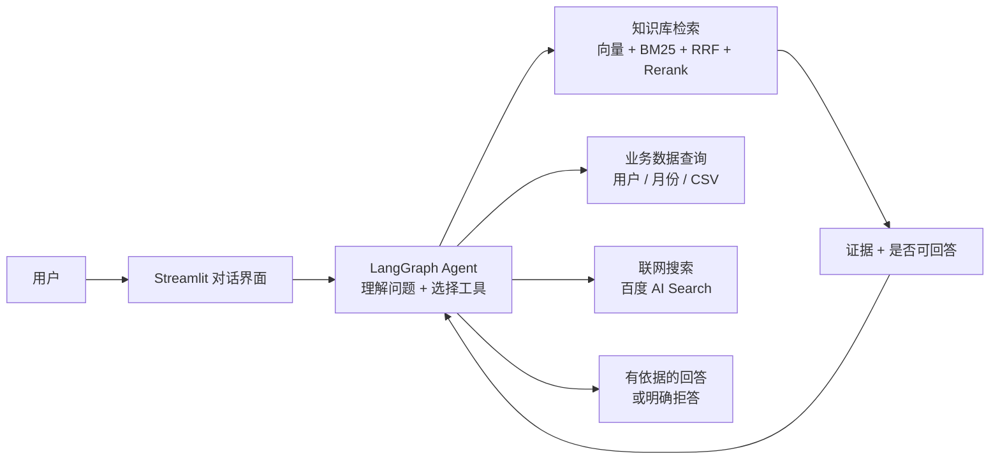
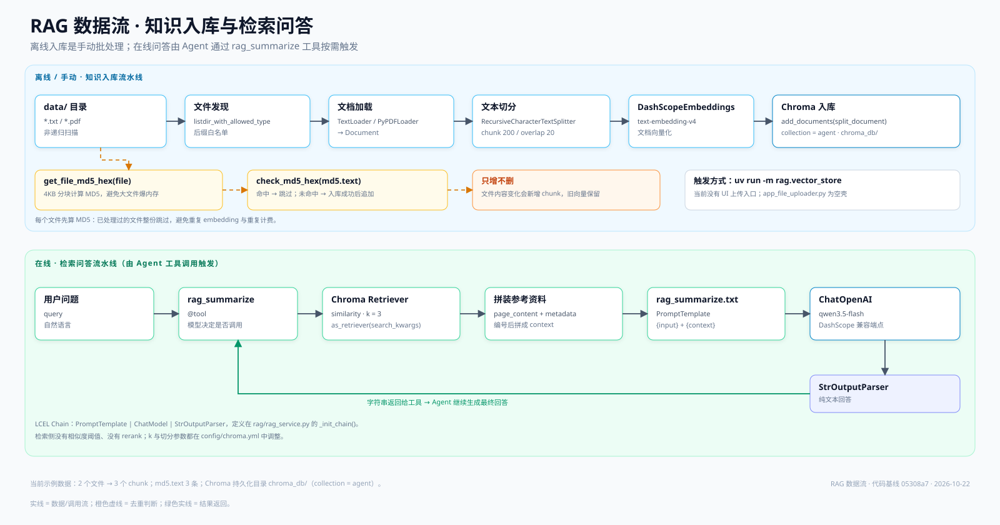
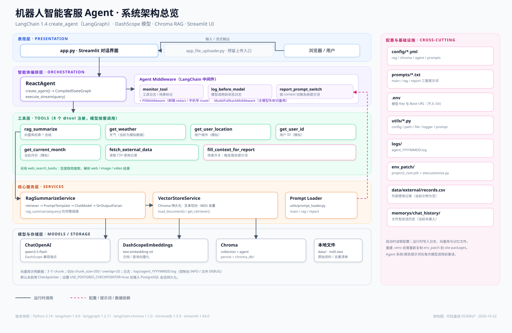

# 机器人智能客服 Agent

**一个会查资料、查业务数据、写报告的对话式客服 Demo。**

基于 LangChain 1.x + LangGraph + Chroma + Streamlit 构建。这个项目重点不是“让模型聊起来”，而是让它在回答前先找证据、回答时能给出处、证据不足时敢说“不知道”。

> 这是一个个人学习 / 原型项目，不是可以直接上生产的客服系统。它适合想理解 Agent 工具调用、RAG 检索与评测、以及“如何让大模型少胡说”的读者。

---

## 1. 它能做什么

把用户的问题交给它，它会根据问题类型做不同的事：

| 用户问什么 | 它会怎么做 |
| --- | --- |
| “学而时习之是什么意思？” | 去本地知识库检索，整理证据后回答，尽量给出文件名、标题、页码 |
| “帮我看看用户 1001 这个月用得怎么样？” | 查业务数据，按用户和月份生成使用报告（需要先接入自己的 CSV 数据） |
| “今天深圳天气怎么样？” | 调用天气工具；当前是模拟数据，接入真实接口后即可替换 |
| “论语里有没有讲股票投资？” | 先判断证据够不够；不够就明确拒答，不靠模型常识硬编 |
| “最近有什么新闻？” | 配置百度 AI Search Key 后，可以联网搜索实时信息 |

具体能力清单：

| 能力 | 说明 | 状态 |
| --- | --- | --- |
| 知识库问答 | 从本地 PDF / TXT 中检索并回答 | 已接入 |
| 混合检索 | 向量检索 + BM25 关键词检索 + RRF 融合 + Rerank 精排 | 已接入 |
| 父子分块 | 子块负责精准召回，父块补足上下文 | 已接入 |
| 可回答性判断 | 先判断证据是否足够；不足时拒答 | 已接入 |
| 证据契约 | 返回结构化 `evidence[] + answerable + status` | 已接入 |
| 业务数据查询 | 按用户 ID + 月份查询使用记录 | 示例数据 |
| 报告场景 | 识别“生成报告”意图并切换提示词 | 已接入 |
| 多轮记忆 | 短期记忆 / 本地 JSON / PostgreSQL | 已接入 |
| 联网搜索 | 百度 AI Search | 已接入，需配置 Key |
| 稳定性 | 模型降级、精排降级、熔断、trace、缓存 | 已接入 |
| 文件上传入库 | 预留页面 | 未实现 |
| 登录 / 鉴权 / 限流 | 生产化能力 | 未实现 |

> 天气、用户位置、用户 ID、当前月份目前是模拟数据；`data/external/records.csv` 默认是空文件，报告场景需要自己填入业务数据后才能看到真实结果。

---

## 2. 30 秒看懂它怎么工作

把 Agent 想成一个客服：

1. 先听懂问题；
2. 判断该查知识库、查业务数据，还是联网搜索；
3. 把查到的材料整理成答案；
4. 如果材料不够，直接说“根据现有资料无法回答”。

对应到项目里，是三层：

- **对话层**：Streamlit 网页，负责输入、流式输出和会话管理。
- **决策层**：LangGraph Agent，模型自主决定调用哪个工具；中间件负责日志、脱敏、模型降级和提示词切换。
- **知识层**：RAG 检索子 Agent，负责“找证据”和“判断证据够不够”。



### RAG 这条线做了什么

可以把知识库想成一座图书馆：

- **入库**：把 PDF / TXT 切成“父块 + 子块”，给每个块建立稳定编号和元数据；
- **召回**：向量检索负责“按意思找”，BM25 负责“按关键词找”；
- **融合**：RRF 把两边的书单合并，Rerank 再逐本判断哪几本最相关；
- **扩展**：命中子块后，按 `parent_id` 找回父块，补足上下文；默认子块 240 字符、重叠 40 字符，父块 900 字符；
- **把关**：判断这些材料里到底有没有答案；没有就让主 Agent 拒答。



系统整体分层：



---

## 3. 效果：不是“感觉更准”，而是量出来的

项目里有一套离线评测：同一份索引、同一批问题，只切换检索链路，比较召回质量。

测试语料是 **71 条 Golden Set**（《论语》50 条 + 需求文档 21 条），另有 **32 条《道德经》困难集**用于第二语料对比。其中需求文档 21 条为本地生成、不随仓库提交；部分 PDF 语料也因版权/体积原因未入库，公开仓库复现时需自备同版本文件。

| 检索方案 | Recall@10 | MRR@10 | NDCG@10 | 平均耗时 |
| --- | ---: | ---: | ---: | ---: |
| 纯向量检索 | 0.6718 | 0.4819 | 0.4862 | 196 ms |
| + BM25 + RRF（混合检索） | 0.7041 | 0.5962 | 0.5752 | 222 ms |
| + qwen3-rerank（当前默认） | **0.8061** | **0.7722** | **0.7437** | 433 ms |
| + qwen3-vl-rerank（备选） | 0.8059 | 0.7993 | 0.7667 | 622 ms |

> 平均耗时受网络、模型额度和运行环境影响，只作量级参考。

相对混合检索，默认的 `qwen3-rerank` 把 Recall@10 提升了约 **14.5%**，MRR 提升了约 **29.5%**，NDCG 提升了约 **29.3%**。作为参照，随机命中 Recall@10 只有 **0.0866**。

为什么默认不用排序略好的 `qwen3-vl-rerank`？

- 它的 MRR / NDCG 略高，但平均延迟高约 44%；
- 它的分数分布不适合直接做拒答阈值，而 `qwen3-rerank` 更均衡；
- 当前默认选择是“质量、延迟、成本、可校准性”的折中，不是单纯追求第一名。

> 这是项目内的小规模评测，不是通用榜单。换语料、换模型、换索引后，数字不能直接比较。评测方法与完整对比见 [rerank 模型对比报告](docs/rag-improvement/07-rerank模型对比报告.md)。

工程质量方面：**37 条单元测试全部通过**，覆盖分块、BM25、RRF、证据契约、索引清单和拒答护栏。

---

## 4. 快速开始

### 1. 准备环境

需要：

- Python 3.13+
- [uv](https://docs.astral.sh/uv/)
- 一个 DashScope API Key（对话、Embedding、Rerank 都会用到）

可选：

- 百度 AI Search Key（联网搜索）
- PostgreSQL（跨进程会话记忆）

### 2. 安装依赖

```powershell
git clone https://github.com/AX3031/RAG_Agent02/tree/dev01
cd project2
uv sync
```

> 如果 `uv sync` 新建了 `.venv`，而你要在 IDE 里直接运行 `.py`，请把 `env_patch/project2_root.pth` 和 `env_patch/sitecustomize.py` 复制到 `.venv/Lib/site-packages/`（Windows）。用 `uv run -m ...` 从项目根运行可以避开导入问题。

### 3. 配置 `.env`

在项目根目录创建 `.env`（该文件已被 `.gitignore` 忽略，不要提交）：

| 变量名 | 是否必需 | 用途 |
| --- | --- | --- |
| `OPEN_API_KEY` | 是 | DashScope OpenAI 兼容模式 Key（注意不是 `OPENAI_API_KEY`） |
| `BASE_URL_DASHSCOPE` | 是 | DashScope OpenAI 兼容端点 |
| `DASHSCOPE_API_KEY` | 是 | Embedding 与 Rerank |
| `DB_URL_POSTGRES` | 否 | PostgreSQL 会话记忆 |
| `API_KEY_BAIDU` | 否 | 百度联网搜索 |

一个最小示例：

```dotenv
OPEN_API_KEY=sk-你的DashScopeKey
BASE_URL_DASHSCOPE=https://dashscope.aliyuncs.com/compatible-mode/v1
DASHSCOPE_API_KEY=sk-你的DashScopeKey
```

### 4. 构建知识库

```powershell
# 增量入库：新文件会入库，内容没变的文件会跳过
uv run -m rag.vector_store

# 全量重建
uv run -m rag.vector_store --rebuild
```

默认扫描 `data/` 第一层的 `.txt` / `.pdf`，写入本地 `chroma_db/`，集合名为 `agent_v2`。默认会跳过文件名包含“道德经”的文件，避免实验语料污染主知识库。

如果你想复现《道德经》实验集合：

```powershell
uv run -m rag.vector_store --rebuild `
  --collection agent_dd `
  --index-manifest storage/index_manifest_dd.json `
  --parent-store storage/parents_dd.json `
  --include-keywords 道德经
```

### 5. 启动网页

```powershell
uv run streamlit run app.py
```

打开浏览器中的地址即可对话。

- 对话输入框左侧有一个记忆按钮：可以切换“短期记忆 / 本地 JSON / PostgreSQL”；
- 左侧栏“会话管理”可以修改会话 ID、新建会话、清空记忆；
- 相同会话 ID 在本地文件或 PostgreSQL 模式下可以恢复历史。

### 6. 跑测试与评测

```powershell
# 37 条离线单元测试，不需要网络和模型
uv run -m unittest discover -s tests -v

# 检索评测：dense / hybrid / full 三种模式
uv run -m eval.run_eval --top-k 10
```

评测结果会写入 `eval/results/`，方便和上一次对比。

---

## 5. 项目结构

```text
project2/
├── app.py                    # Streamlit 对话入口
├── agent/
│   ├── react_agent.py        # Agent 组装、流式执行、拒答护栏
│   └── tools/
│       ├── agent_tools.py    # 9 个工具（知识检索、天气、CSV、联网搜索等）
│       └── middleware.py     # 6 个中间件（日志、脱敏、降级、提示词切换）
├── rag/
│   ├── retrieval_service.py  # 混合检索主流程
│   ├── contract.py           # 证据契约与状态机
│   ├── chunking.py           # 父子分块与稳定 chunk_id
│   ├── index_store.py        # 索引清单与父块存储
│   ├── sparse_index.py       # 自研中文 BM25
│   ├── answerability.py      # 可回答性判断
│   ├── telemetry.py          # trace、分段延迟、缓存
│   ├── rag_service.py        # 基于证据的受控生成
│   └── vector_store.py       # 入库、更新、删除、重建
├── eval/                     # Golden Set、指标、评测、阈值校准
├── tests/                    # 37 条 stdlib unittest
├── memorys/                  # 三种会话记忆后端
├── model/                    # Chat / Embedding 工厂
├── utils/                    # 配置、路径、日志、文件、提示词
├── config/                   # rag / chroma / agent / prompts 配置
├── prompts/                  # 系统提示词、RAG 提示词、报告提示词
├── data/                     # 知识文件与业务 CSV
├── docs/                     # 架构文档、SVG、RAG 改造记录
└── env_patch/                # 虚拟环境补丁
```

---

## 6. 技术栈

| 层 | 组件 | 版本 |
| --- | --- | --- |
| 运行时 | Python | 3.13+（开发环境 3.14） |
| 包管理 | uv | 0.12.x |
| Agent 框架 | langchain / langgraph | 1.4.0 / 1.2.11 |
| Web UI | streamlit | 1.64.0 |
| 向量库 | langchain-chroma / chromadb | 1.1.0 / 1.5.9 |
| 模型服务 | DashScope | 1.27.5 |
| 对话模型 | qwen3.5-flash | - |
| 备用模型 | glm-5 | - |
| Embedding | text-embedding-v4 | - |
| Rerank | qwen3-rerank | - |
| 可回答性判断 | qwen-flash | - |
| 稀疏检索 | 自研 BM25（中文 unigram + bigram） | 无额外依赖 |
| 会话记忆 | InMemory / JSON / PostgreSQL | - |
| 文档解析 | pypdf | 6.18.1 |
| 评测 | 标准库实现 Recall / MRR / NDCG | - |

对话模型通过 DashScope 的 OpenAI 兼容端点接入；Embedding 与 Rerank 使用 DashScope SDK。换模型主要改 `config/rag.yml`。

---

## 7. 配置入口速查

| 想改什么 | 改哪里 |
| --- | --- |
| 换对话 / Embedding / Rerank 模型 | `config/rag.yml` |
| 调召回数量、RRF、精排、可回答性阈值 | `config/rag.yml` 的 `retrieval:` 段 |
| 调分块大小、集合名、索引清单路径 | `config/chroma.yml` |
| 换业务 CSV 路径 | `config/agent.yml` |
| 换提示词 | `prompts/*.txt` |
| 新增工具 | `agent/tools/agent_tools.py` + `agent/react_agent.py` |
| 切换会话记忆方式 | 网页输入框左侧的记忆按钮 |

---

## 8. 已知限制

先说清楚，避免误解：

1. **这是原型，不是生产系统**：没有登录、鉴权、多租户、限流、计费和高可用。
2. **部分工具是模拟数据**：天气、位置、用户 ID、当前月份返回模拟值；业务 CSV 默认是空文件，报告场景需要自己填数据。
3. **Rerank 依赖外部额度**：额度耗尽或超时会自动降级为 RRF 排序，系统仍能工作，但精度会下降。
4. **评测规模有限**：71 + 32 条，没有做统计显著性检验，数字只代表当前语料和当前索引快照。
5. **扫描版 PDF 不支持**：没有 OCR，只能解析可提取文本的 PDF / TXT。
6. **PII 覆盖不完整**：目前只处理模型输入 / 输出，日志还没有系统性脱敏。
7. **文件上传入库未实现**：`app_file_uploader.py` 目前是空壳。
8. **分块按字符计**：尚未接入 tokenizer。

完整技术债和修复建议见 [ARCHITECTURE.md 第 12 节](docs/ARCHITECTURE.md#12-已知问题与技术债)。

---

## 9. 文档导航

| 文档 | 适合谁看 |
| --- | --- |
| [PROJECT_OVERVIEW.md](docs/PROJECT_OVERVIEW.md) | 想 5 分钟了解项目全貌 |
| [ARCHITECTURE.md](docs/ARCHITECTURE.md) | 想改代码、排障、了解模块设计 |
| [architecture.svg](docs/architecture.svg) | 想看分层架构图 |
| [rag-pipeline.svg](docs/rag-pipeline.svg) | 想看知识入库与检索数据流 |
| [rag-improvement/00-进度备忘录.md](docs/rag-improvement/00-进度备忘录.md) | 想看 RAG 改造的过程、决策与反思 |
| [rag-improvement/07-rerank模型对比报告.md](docs/rag-improvement/07-rerank模型对比报告.md) | 想看 rerank 模型对比与选型 |
| [CHANGELOG.md](CHANGELOG.md) | 想知道最近改了什么 |
| [README-开发版.md](docs/README-开发版.md) | 旧版开发者 README（已归档，保留作参考） |

---

## 10. 安全与公开仓库提示

- `.env` 已被 `.gitignore` 忽略，不要把 API Key、数据库连接串写进代码或文档。
- RAG trace 只记录 `query_hash`、`doc_id`、`evidence_id` 和分段延迟，不记录完整 query 与证据正文；但其他日志仍可能包含用户输入，接入真实业务前需要统一脱敏。
- 项目默认通过 `.gitignore` 忽略新加入的 `data/*.pdf`。公开仓库前，请确认示例语料的版权和使用权限。
- 当前仓库没有声明开源许可证。如果要公开分发，建议先补充 `LICENSE`。

---

## 最后

这个项目最想证明的一件事是：

> 一个靠谱的客服 Agent，不是“什么问题都能答”，而是知道**什么时候该查、去哪里查、查到什么程度、什么时候该停**。

如果你也在做类似的事情，欢迎从 `rag/retrieval_service.py` 和 `eval/run_eval.py` 开始看。
