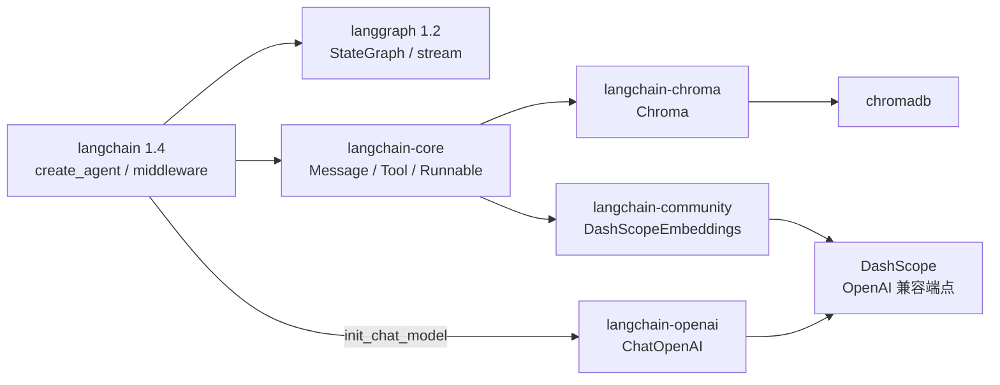
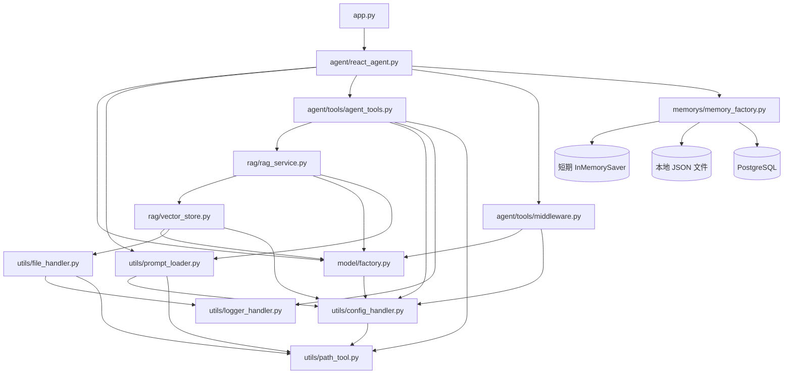
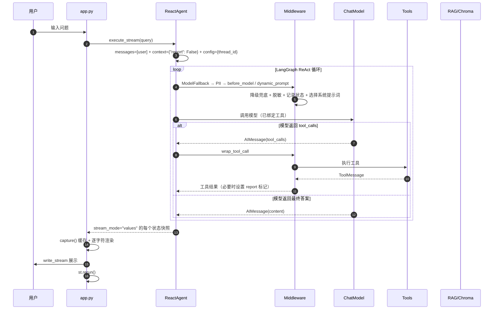
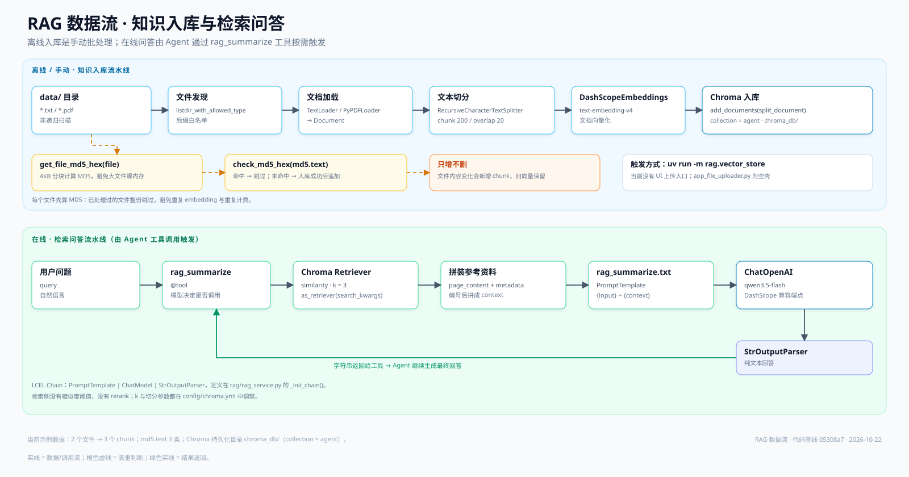
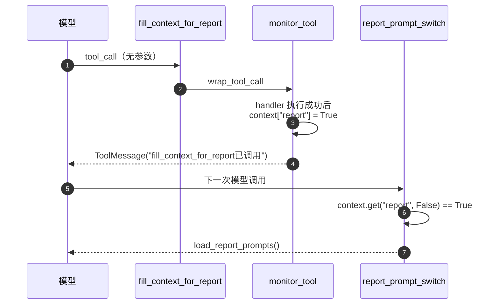

# 系统架构说明

> 面向对象：需要接手、扩展或排查该项目的开发/运维人员。
>
> 代码基线：`05308a7`（2026-10-22 工作区快照）。
>
> 配套图：[architecture.svg](architecture.svg)（分层架构）、[rag-pipeline.svg](rag-pipeline.svg)（RAG 数据流）。
>
> 维护约定：改动模块职责、配置项、主链路或扩展方式时，同步更新本文与对应 SVG。
>
> 快速入口：[1 页速览](PROJECT_OVERVIEW.md) · [README 快速开始](../README.md#4-快速开始) · [AGENTS.md](../AGENTS.md)

---

## 导读

### 按目标选路线

| 目标 | 建议阅读 | 时间 |
| --- | --- | --- |
| 5 分钟了解项目 | 第 2、4 节 + [1 页速览](PROJECT_OVERVIEW.md) | 5 分钟 |
| 30 分钟建立整体认知 | 第 5、6 节 + README 的代码阅读路线 | 30 分钟 |
| 要加功能 | 第 5、9、13 节 | 30–60 分钟 |
| 要排障/上线 | 第 6、10、11、12 节 | 按需 |
| 查术语/命令 | [第 15 节](#15-术语表)、[第 16 节](#16-附录) | 按需 |

### 按问题找章节

| 我想知道 | 看这里 |
| --- | --- |
| 项目怎么跑起来？ | [README 快速开始](../README.md#4-快速开始) |
| 整体分几层、用了什么？ | [第 4 节](#4-总体架构) + [architecture.svg](architecture.svg) |
| 一次请求怎么走？ | [第 6 节](#6-运行时主链路) |
| RAG 怎么入库/检索？ | [第 7 节](#7-rag-子系统) + [rag-pipeline.svg](rag-pipeline.svg) |
| 报告场景怎么切换？ | [第 8 节](#8-报告场景与动态提示词) |
| 配置在哪改？ | [第 9 节](#9-配置体系) + [README 配置速查](../README.md#7-配置入口速查) |
| 想加工具/上传/记忆？ | [第 13 节](#13-扩展指南) |
| 有什么坑/技术债？ | [第 12 节](#12-已知问题与技术债) |
| 启动失败/日志在哪？ | [第 11 节](#11-可观测性与错误处理) + [16.2](#162-常用命令) |

### 章节目录

1. [文档目标](#1-文档目标)
2. [项目定位与边界](#2-项目定位与边界)
3. [技术栈与组件矩阵](#3-技术栈与组件矩阵)
4. [总体架构](#4-总体架构)
5. [目录与模块职责](#5-目录与模块职责)
6. [运行时主链路](#6-运行时主链路)
7. [RAG 子系统](#7-rag-子系统)
8. [报告场景与动态提示词](#8-报告场景与动态提示词)
9. [配置体系](#9-配置体系)
10. [数据与持久化](#10-数据与持久化)
11. [可观测性与错误处理](#11-可观测性与错误处理)
12. [已知问题与技术债](#12-已知问题与技术债)
13. [扩展指南](#13-扩展指南)
14. [演进路线](#14-演进路线)
15. [术语表](#15-术语表)
16. [附录](#16-附录)

---

## 1. 文档目标

这份文档回答四个问题：

1. 这个项目现在**由哪些部分组成**，每部分用什么技术、承担什么职责。
2. 一次用户请求**如何流经** UI、Agent、中间件、模型、工具、RAG 和存储。
3. 想加东西时**应该改哪里**，有哪些现成的扩展点。
4. 当前有哪些**已知问题和技术债**，哪些会影响二次开发。

状态标记：

| 标记 | 含义 |
| --- | --- |
| ✅ | 已接入主链路，正常路径会执行 |
| 🧪 | 示例、实验或预留，主链路未依赖 |
| ⚙️ | 基础设施/公共能力 |
| ⚠️ | 已知问题，见第 12 节 |

---

## 2. 项目定位与边界

### 2.1 业务定位

一个“机器人/设备智能客服”原型：

- 回答产品知识库相关问题（RAG）。
- 按需获取用户所在城市、用户 ID、当前月份、天气等上下文。
- 查询指定用户在某月的使用记录（当前为 CSV 示例）。
- 在“报告生成”场景切换到另一套系统提示词。

### 2.2 技术定位

- 单进程 Python 应用，Streamlit 提供 Web UI。
- LangChain 1.x `create_agent` 构建 LangGraph Agent，模型自主决定调用哪些工具。
- Chroma 本地持久化向量库，DashScope 提供对话与 Embedding 模型。
- 配置外置到 YAML + `.env`，提示词外置到 `prompts/*.txt`。

### 2.3 明确不包含

| 能力 | 现状 |
| --- | --- |
| 用户登录、鉴权、租户隔离 | 未实现 |
| 生产级会话持久化 | 未接入 Agent 主链路 |
| 限流、计费、审计 | 未实现 |
| 高可用/水平扩展 | 单进程、本地 Chroma，不支持多 worker 共享状态 |
| 真实天气/定位/用户系统 | 工具返回模拟数据 |
| 文件上传入库 UI | `app_file_uploader.py` 为空壳 |
| 自动化测试/CI | 无 |

> 结论：当前适合做原型验证和 LangChain Agent 二次开发脚手架，不应直接按生产系统对外承诺 SLA。

---

## 3. 技术栈与组件矩阵

> 版本来自当前 `.venv` 的 `importlib.metadata` 快照；升级依赖后请同步本表。

| 层次 | 组件 | 版本 | 职责 | 接入位置 |
| --- | --- | --- | --- | --- |
| 运行时 | CPython | 3.14（`pyproject` 要求 ≥3.13） | 解释器 | `.venv/` |
| 包管理 | uv | 0.12.9 | 依赖安装、锁文件、命令执行 | `pyproject.toml` / `uv.lock` |
| Web UI | streamlit | 1.64.0 | 对话界面、流式渲染、会话状态 | `app.py` |
| Agent 框架 | langchain | 1.4.0 | `create_agent`、中间件、`@tool` | `agent/react_agent.py` |
| 图运行时 | langgraph | 1.2.11 | StateGraph、`stream`、运行时 context | 由 `create_agent` 内部使用 |
| 状态持久化 | langgraph checkpointer / langgraph-checkpoint-postgres / psycopg / psycopg-pool | 1.2.11 / 3.2.0 / 3.3.6 / 3.3.3 | 短期内存、本地 JSON、PostgreSQL 三种 checkpointer | `memorys/memory_factory.py`、`file_checkpointer.py`、`postgres_checkpointer.py` |
| 核心抽象 | langchain-core | 1.6.5 | Message、Tool、Runnable、Prompt | 全项目 |
| 模型接入 | langchain / langchain-openai | 1.4.0 / 1.6.6 | `init_chat_model(model_provider="openai")` 实例化官方 `ChatOpenAI`，调用 OpenAI 兼容端点 | `model/factory.py` |
| 社区集成 | langchain-community | 0.4.2 | `DashScopeEmbeddings`、PDF/TXT Loader | `model/factory.py`、`utils/file_handler.py` |
| 向量库 | langchain-chroma / chromadb | 1.1.0 / 1.5.9 | 本地持久化向量检索 | `rag/vector_store.py` |
| 文本切分 | langchain-text-splitters | 1.1.2 | `RecursiveCharacterTextSplitter` | `rag/vector_store.py` |
| 模型 SDK | dashscope | 1.27.5 | 通义千问/Embedding 服务 | 由 `DashScopeEmbeddings` 使用 |
| OpenAI SDK | openai | 3.19.2 | `ChatOpenAI` 的 HTTP 客户端（传递依赖） | `langchain-openai` |
| 文档解析 | pypdf | 6.18.1 | PDF 文本提取 | `utils/file_handler.py` |
| 配置 | PyYAML | 6.0.3 | 读取 `config/*.yml` | `utils/config_handler.py` |
| 环境变量 | python-dotenv | 1.2.3 | 加载 `.env` | `model/factory.py` |
| HTTP 客户端 | requests | 2.34.2 | 百度联网搜索 | `agent/tools/agent_tools.py` |
| 追踪 | langsmith | 0.12.2 | 传递依赖；当前未显式启用 | — |

### 3.1 框架关系



关键点：

- `create_agent` 返回的是 LangGraph 的 `CompiledStateGraph`，不是旧版 `AgentExecutor`。
- 中间件是 LangChain 1.x Agent 的扩展机制，本项目用了 `wrap_tool_call`、`before_model`、`dynamic_prompt`，并接入内置的 `PIIMiddleware` 与 `ModelFallbackMiddleware`。
- 对话模型统一由 `langchain.chat_models.init_chat_model(model_provider="openai")` 在 `model/factory.py` 构造，实际对象仍是官方维护的 `langchain_openai.ChatOpenAI`；`langchain_community` 里的同名副本已不再 import。
- RAG 不依赖 Agent 框架，是一条独立 LCEL 链（`PromptTemplate | ChatModel | StrOutputParser`），再作为一个工具暴露给 Agent。
- `langchain-community` 已进入 sunset（安装/导入时会出现 DeprecationWarning），当前 `DashScopeEmbeddings` 仍来自该包；长期应迁移到独立集成包，或直接用 `dashscope` SDK 封装一个 `Embeddings` 实现。

---

## 4. 总体架构


### 4.1 分层职责

| 层 | 组成 | 职责 | 关键约束 |
| --- | --- | --- | --- |
| L1 表现层 | `app.py`、`app_file_uploader.py` | 收集输入、展示流式输出、保存 UI 会话状态 | 不直接调用模型/工具 |
| L2 编排层 | `ReactAgent`、`create_agent`、六个中间件 | 组装模型/工具/提示词，驱动 ReAct 循环 | 模型决定工具调用顺序 |
| L3 工具层 | 8 个 `@tool` 函数 | 把外部能力封装成模型可调用的工具 | 入参/返回需可序列化 |
| L4 服务层 | `RagSummarizeService`、`VectorStoreService`、`PromptLoader` | RAG 检索与总结、向量入库、提示词加载 | 与 Agent 解耦，可单独测试 |
| L5 模型/存储层 | `ChatOpenAI`、`DashScopeEmbeddings`、Chroma、PostgreSQL（可选）、本地文件 | 模型推理、向量化、持久化 | 模型/维度变更需重建向量库 |
| L6 横切层 | `config/`、`prompts/`、`utils/`、`logs/`、`env_patch/` | 配置、路径、日志、编码补丁 | 启动时加载，运行时只读为主 |

### 4.2 关键设计决策

1. **用 `create_agent` 而不是手写 ReAct 循环**：把“模型调用 → 工具执行 → 再调用模型”的循环交给 LangGraph，项目只负责工具、提示词和中间件。
2. **RAG 作为工具而非固定前置步骤**：`rag_summarize` 由模型按需调用；闲聊/天气类问题不会强制走知识库。
3. **中间件承载横切逻辑**：工具日志、模型前日志、提示词切换都不侵入工具与模型代码。
4. **动态提示词用 `runtime.context` 标记**：`fill_context_for_report` 工具触发后，`monitor_tool` 把 `context["report"]` 置为 `True`，下一次模型调用由 `report_prompt_switch` 切换提示词。
5. **配置与提示词外置**：模型名、切分参数、路径、提示词都不写死在代码里，便于替换与灰度。
6. **绝对路径统一入口**：`utils/path_tool.get_abs_path()` 基于文件位置推导项目根，避免依赖当前工作目录。
7. **Chroma 本地持久化 + MD5 去重**：适合单机原型；重复执行入库不会重复 embedding 同一文件。
8. **OpenAI 兼容协议做模型适配层**：`ChatOpenAI` + `BASE_URL_DASHSCOPE` 可以较低成本切换供应商。

### 4.3 主链路与非主链路

| 类别 | 文件 | 说明 |
| --- | --- | --- |
| 主链路 | `app.py` → `agent/react_agent.py` → `agent/tools/*` → `rag/*` → `model/factory.py` | 一次对话实际执行的路径 |
| 主链路依赖 | `utils/*`、`config/*`、`prompts/*`、`data/*`、`chroma_db/*` | 被主链路读取/写入 |
| 实验/预留 | `memorys/persistent_memory.py`、`memorys/temporary_memory.py`、`app_file_uploader.py` | 会话历史示例 / 空壳；主链路未直接 import |
| 记忆链路 | `memorys/memory_factory.py`、`file_checkpointer.py`、`postgres_checkpointer.py` | 由 `app.py` 选择的记忆方式驱动 `ReactAgent` 创建对应 checkpointer |
| 模板/临时 | `main.py`、`test1.py` | 无业务逻辑，可删除或替换 |

---

## 5. 目录与模块职责

### 5.1 目录树

```text
project2/
├── README.md                    # ✅ 项目入口、导读与命令
├── AGENTS.md                    # ⚙️ AI 阅读约定
├── CHANGELOG.md                 # ✅ 重要变更日志（Keep a Changelog）
├── app.py                       # ✅ Streamlit 对话入口
├── app_file_uploader.py         # 🧪 文件上传（空壳）
├── main.py                      # 🧪 PyCharm 默认模板
├── test1.py                     # 🧪 临时脚本
├── pyproject.toml               # 依赖声明
├── uv.lock                      # 锁定版本
├── .env                         # 本地密钥（git 忽略）
├── agent/
│   ├── react_agent.py           # ✅ Agent 组装 + 流式执行
│   └── tools/
│       ├── agent_tools.py       # ✅ 8 个工具 + 外部数据加载
│       └── middleware.py        # ✅ 6 个中间件
├── rag/
│   ├── rag_service.py           # ✅ 检索 + 总结 LCEL 链
│   └── vector_store.py          # ✅ Chroma 入库/检索/MD5
├── model/
│   └── factory.py               # ✅ Chat/Embedding 工厂
├── memorys/
│   ├── memory_factory.py        # ✅ 记忆方式工厂（短期/文件/PostgreSQL）
│   ├── file_checkpointer.py     # ✅ JSON 文件型 checkpointer
│   ├── postgres_checkpointer.py # 🧪 PostgreSQL checkpointer（可选）
│   ├── persistent_memory.py     # 🧪 文件型会话历史（示例）
│   └── temporary_memory.py      # 🧪 内存型会话历史（示例）
├── utils/
│   ├── config_handler.py        # ⚙️ YAML 加载
│   ├── prompt_loader.py         # ⚙️ 提示词加载
│   ├── path_tool.py             # ⚙️ 项目根/绝对路径
│   ├── file_handler.py          # ⚙️ MD5/文件发现/Loader
│   └── logger_handler.py        # ⚙️ 日志
├── config/                      # ⚙️ rag/chroma/prompts/agent
├── prompts/                     # ⚙️ 三套提示词
├── data/                        # 知识文件 + external/records.csv
├── chroma_db/                   # Chroma 持久化
├── md5.text                     # 已入库 MD5 清单
├── logs/                        # 按日日志
├── env_patch/                   # ⚙️ .pth + sitecustomize.py
└── docs/                        # 速览、架构文档与 SVG
```

### 5.2 模块职责表

| 模块 | 关键符号 | 职责 | 上游/下游 |
| --- | --- | --- | --- |
| `app.py` | `st.session_state`、`st.bottom`、`popover`、`radio`、`_reset_chat`、`_load_history`、`capture`、`write_stream` | 页面渲染；底部栏（`st.bottom` + 水平容器）内左侧记忆按钮、右侧 `chat_input`；弹层里选择记忆方式；侧边栏「会话管理」维护会话 ID/新建会话/清空记忆 | 上游：用户；下游：`ReactAgent`、`memory_factory` |
| `agent/react_agent.py` | `ReactAgent.__init__`、`execute_stream`、`clear_memory`、`load_ui_messages` | 用 `create_agent` 组装模型、8 个工具、6 个中间件；按 `memory_mode` 创建 checkpointer；过滤 `AIMessage` 流式输出 | 上游：`app.py`；下游：模型、工具、中间件、记忆工厂 |
| `agent/tools/agent_tools.py` | `rag_summarize`、`get_weather`、`get_user_location`、`get_user_id`、`get_current_month`、`fetch_external_data`、`fill_context_for_report`、`web_search_baidu` | 工具实现；模块级 `rag = RagSummarizeService()`；CSV 懒加载缓存；百度联网搜索 | 上游：模型 tool_call；下游：RAG、CSV、百度 AI Search |
| `agent/tools/middleware.py` | `monitor_tool`、`log_before_model`、`report_prompt_switch`、`pii_middleware_email`、`pii_middleware_phone`、`model_fallback_middleware` | 工具日志/场景标记、模型前日志、动态提示词、PII 脱敏、模型降级 | 被 `create_agent` 调用 |
| `rag/rag_service.py` | `RagSummarizeService`、`_init_chain`、`retriever_docs`、`rag_summarize` | 检索文档、拼装 context、调用 LCEL 链生成总结 | 上游：`rag_summarize` 工具；下游：Chroma、ChatModel |
| `rag/vector_store.py` | `VectorStoreService`、`load_document`、`get_retriever`、`check_md5_hex`、`save_md5_hex` | Chroma 初始化、文本切分、入库、MD5 去重、检索器 | 上游：手动入库/`RagSummarizeService`；下游：Chroma、Embedding |
| `model/factory.py` | `BaseModelFactory`、`ChatModelFactory`、`EmbeddingsFactory`、`chat_model`、`embed_model` | 创建 Chat/Embedding 单例；加载 `.env` | 被 RAG、工具、Agent 使用 |
| `utils/config_handler.py` | `rag_conf`、`chroma_conf`、`prompts_conf`、`agent_conf` | 启动时读取四份 YAML | 被全项目引用 |
| `utils/prompt_loader.py` | `load_system_prompts`、`load_rag_prompts`、`load_report_prompts` | 按配置路径读取提示词文件 | 被 Agent/中间件/RAG 使用 |
| `utils/path_tool.py` | `get_project_root`、`get_abs_path` | 基于 `utils/` 位置推导项目根 | 被所有路径读取使用 |
| `utils/file_handler.py` | `get_file_md5_hex`、`listdir_with_allowed_type`、`pdf_loader`、`txt_loader` | MD5 计算、文件发现、文档加载 | 被 `VectorStoreService` 使用 |
| `utils/logger_handler.py` | `get_logger`、`logger` | 控制台 INFO + 按日文件 DEBUG；幂等 Handler | 被工具/中间件/入库使用 |
| `memorys/memory_factory.py` | `MEMORY_MODE_LABELS`、`DEFAULT_MEMORY_MODE`、`create_checkpointer` | 记忆方式枚举与 checkpointer 工厂；PostgreSQL 分支延迟导入 | 被 `agent/react_agent.py` 使用 |
| `memorys/file_checkpointer.py` | `FileCheckpointSaver`、`get_file_checkpointer` | 继承 `InMemorySaver`，把 storage/writes/blobs 原子写入 JSON；进程内单例 | 被 `memory_factory.py` 使用 |
| `memorys/postgres_checkpointer.py` | `get_checkpointer`、`close_pool` | PostgreSQL checkpointer（连接池 + 幂等建表）；选择 PostgreSQL 模式时使用 | 被 `memory_factory.py` 使用 |
| `memorys/persistent_memory.py` | `FileChatMessageHistory`、`conversation_chain` | 文件型会话历史 + `RunnableWithMessageHistory` 示例 | 🧪 未接入主链路 |
| `memorys/temporary_memory.py` | `store`、`conversation_chain` | 内存型会话历史示例 | 🧪 未接入主链路 |
| `app_file_uploader.py` | 无 | 预留的文件上传页面 | 🧪 空壳 |

### 5.3 模块依赖关系



### 5.4 导入期副作用（重要）

很多初始化不是发生在函数里，而是发生在 **import 时**：

1. `utils.config_handler` 被首次 import 时，读取 `config/rag.yml`、`chroma.yml`、`prompts.yml`、`agent.yml`，生成四个全局字典。
2. `model.factory` 被 import 时执行 `load_dotenv()`，并创建 `chat_model`、`embed_model` 两个全局实例。
3. `agent.tools.agent_tools` 被 import 时执行 `rag = RagSummarizeService()`：
   - `VectorStoreService()` 打开/创建 `chroma_db/`；
   - `load_rag_prompts()` 读取 RAG 提示词；
   - 构建 `PromptTemplate` 与 LCEL 链。
4. `utils.logger_handler` 被 import 时创建 `logs/` 并注册控制台/文件 Handler。
5. `agent.tools.middleware` 被 import 时会创建 `PIIMiddleware` 与备用 `ChatOpenAI` 实例（读取 `backup_chat_model_name`），但不会连接 PostgreSQL。
6. PostgreSQL 连接只发生在 `USE_POSTGRES_CHECKPOINTER=true` 且 `ReactAgent` 初始化时，由 `get_checkpointer()` 惰性建立；默认关闭。

影响：

- 即使只 import `ReactAgent`，也会初始化 Chroma 和模型客户端。
- 配置错误、`.env` 缺失、Chroma 目录不可写，会在**应用启动阶段**失败，而不是首次请求时。
- 单元测试需要 monkeypatch 这些模块级对象，或把初始化改为惰性/依赖注入（见 13.10）。

---

## 6. 运行时主链路

### 6.1 时序图



### 6.2 分步说明

**步骤 1：页面初始化**

`app.py` 在 `st.session_state` 中检查 `"agent"`，不存在则 `ReactAgent()`。同一个浏览器会话内 Agent 只创建一次；刷新页面/新标签页会重新创建。

**步骤 2：组装 Agent**

`ReactAgent.__init__` 调用：

```python
create_agent(
    model=chat_model,
    system_prompt=load_system_prompts(),
    tools=[
        rag_summarize, get_weather, get_user_location, get_user_id,
        get_current_month, fetch_external_data, fill_context_for_report,
        web_search_baidu,
    ],
    middleware=[
        model_fallback_middleware, pii_middleware_email, pii_middleware_phone,
        monitor_tool, log_before_model, report_prompt_switch,
    ],
    checkpointer=self.checkpointer,  # 按 memory_mode 创建：短期/文件/PostgreSQL
)
```

`system_prompt` 是构造时的默认提示词；由于注册了 `dynamic_prompt` 中间件，每次模型调用前会重新选择提示词，实际生效的是中间件返回值。

**步骤 3：发起请求**

```python
input_dict = {"messages": [{"role": "user", "content": query}]}
config = {"configurable": {"thread_id": thread_id}}
agent.stream(input_dict, stream_mode="values", context={"report": False}, config=config)
```

注意：

- 只发送当前问题；checkpointer 始终存在，同一 `thread_id` 会由 LangGraph 自动恢复历史。
- `context` 是每次请求新建的字典 → 报告标记不会泄漏到下一次请求。
- `stream_mode="values"` 表示“每一步后输出完整状态”，不是 token 流。

**步骤 4：模型与工具循环**

LangGraph 内部循环：

1. `ModelFallbackMiddleware` 包裹模型调用：主模型失败时自动切换备用模型。
2. `PIIMiddleware` 在输入侧 mask 手机号、输出侧 redact 邮箱。
3. `before_model`：记录消息数量与最后一条消息。
4. `dynamic_prompt`：根据 `runtime.context["report"]` 返回主提示词或报告提示词。
5. 模型返回 `AIMessage`：可能带 `tool_calls`，也可能直接是最终答案。
6. 若有 `tool_calls`，`wrap_tool_call` 包装的工具节点执行工具，生成 `ToolMessage`。
7. 回到模型，直到没有新的 `tool_calls`。

**步骤 5：流式输出**

`execute_stream` 对每个状态快照取 `chunk["messages"][-1]`，只输出不带 `tool_calls` 的 `AIMessage` 文本：

```python
for chunk in self.agent.stream(...):
    lastest_message = chunk["messages"][-1]
    if isinstance(lastest_message, AIMessage) and not lastest_message.tool_calls:
        if isinstance(lastest_message.content, str) and lastest_message.content.strip():
            yield lastest_message.content.strip() + "\n"
```

**重要行为**：

| 快照 | 最后一条消息 | 是否会被 `yield` | 页面表现 |
| --- | --- | --- | --- |
| 第 1 个 | `HumanMessage`（用户问题） | 否 | 不会重复显示问题 |
| 中间 | `AIMessage(tool_calls)` | 否 | 不显示工具调用中间态 |
| 中间 | `ToolMessage`（工具结果） | 否 | 不显示工具原始结果 |
| 最后 | `AIMessage`（最终答案） | 是 | 正常回答 |

`app.py` 的 `capture` 会缓存所有 chunk，但只把 `response_messages[-1]` 存入 UI 历史；空流时不会写入助手消息。

**步骤 6：页面刷新**

`write_stream` 完成后 `st.rerun()`，重新渲染历史消息。Agent 仍在 `session_state` 中，不会重建；只有切换记忆方式时才会销毁并重建。

### 6.3 当前消息状态示例

```text
HumanMessage("我这里天气怎么样")
AIMessage(tool_calls=[get_user_location])
ToolMessage("深圳")
AIMessage(tool_calls=[get_weather(city="深圳")])
ToolMessage("城市深圳天气为晴天...")
AIMessage("深圳今天晴天，26℃...")
```

### 6.4 多轮记忆（三种后端）

记忆方式由 `ReactAgent(memory_mode=...)` 决定，Streamlit **输入框左侧的记忆按钮**默认是「短期记忆（默认，不存档记忆）」，点击后弹出列表（选项文案见 `MEMORY_MODE_LABELS`）：

| 方式 | checkpointer | 存储位置 | 生命周期 |
| --- | --- | --- | --- |
| `short_term`（默认） | `langgraph.checkpoint.memory.InMemorySaver` | 进程内存 | 重启即丢失 |
| `file` | `memorys/file_checkpointer.py` 的 `FileCheckpointSaver` | `memorys/chat_history/agent_checkpoints.json` | 跨进程保留 |
| `postgres` | `memorys/postgres_checkpointer.py` 的 `PostgresSaver` | PostgreSQL | 跨进程/多实例保留 |

- `execute_stream` 每次只传当前 `HumanMessage`，历史由 checkpointer 依据 `thread_id` 自动恢复。
- `app.py` 的会话 ID 默认 `user_001`，在侧边栏「会话管理」修改；相同 ID 在文件/PostgreSQL 模式会恢复上下文与 UI 聊天记录。
- 侧边栏「清空记忆」调用 `checkpointer.delete_thread(thread_id)`；「新建会话」生成新的随机 ID。
- 弹层底部的 caption 显示当前方式的存储位置；PostgreSQL 连不上时约 5 秒内回退为短期记忆，并在页面顶部提示。
- 未显式传入 `memory_mode` 时，`USE_POSTGRES_CHECKPOINTER=true` 仍可把默认方式切到 PostgreSQL（兼容旧配置）。

接入细节见 13.4。

### 6.5 错误路径

| 场景 | 行为 |
| --- | --- |
| 模型/网络错误 | 异常从 `stream` 抛出，Streamlit 显示错误；无重试 |
| 工具抛异常 | `monitor_tool` 记录错误后 `raise`；是否转成错误 `ToolMessage` 取决于 LangGraph 错误处理配置 |
| 工具参数校验失败 | 由 LangChain 生成错误消息或抛异常 |
| `.env` 缺失/Key 错误 | 模型调用返回认证错误；Embedding 初始化可能直接失败 |
| `chroma_db` 不可写 | 应用启动/首次请求失败 |
| `records.csv` 不存在 | `fetch_external_data` 抛 `FileNotFoundError` |

---

## 7. RAG 子系统



### 7.1 知识入库（离线/手动）

入口：`uv run -m rag.vector_store`

| 步骤 | 代码 | 说明 |
| --- | --- | --- |
| 1. 发现文件 | `listdir_with_allowed_type(data_path, allow_types)` | 只扫描 `data/` 第一层，非递归；后缀白名单来自 `chroma.yml` |
| 2. 计算 MD5 | `get_file_md5_hex(path)` | 4KB 分块读取，避免大文件占内存 |
| 3. 查重 | `check_md5_hex(md5)` | 读取 `md5.text`；文件不存在时创建空文件并返回未处理 |
| 4. 加载 | `txt_loader` / `pdf_loader` | `TextLoader(utf-8)` / `PyPDFLoader` |
| 5. 切分 | `RecursiveCharacterTextSplitter` | `chunk_size=200`、`chunk_overlap=20`、中英文分隔符 |
| 6. 向量化+入库 | `Chroma.add_documents(split_document)` | Embedding 由 `DashScopeEmbeddings` 完成 |
| 7. 记录 MD5 | `save_md5_hex(md5)` | 追加一行到 `md5.text` |
| 8. 异常处理 | 每个文件 `try/except` | 单文件失败记录日志后继续下一个 |

当前数据状态（2026-10-22 快照）：

- `data/`：`测试文本.txt`（27 B）、`测试pdf2.pdf`（约 27 KB）。
- `chroma_db/`：collection `agent`，3 个 chunk。
- `md5.text`：3 条 MD5。
- `data/external/records.csv`：空文件。

### 7.2 在线检索问答

入口：模型调用 `rag_summarize(query)` 工具。

| 步骤 | 代码 | 说明 |
| --- | --- | --- |
| 1. 工具调用 | `agent_tools.rag_summarize` | 工具描述告诉模型“从向量存储中检索参考资料” |
| 2. 取回文档 | `RagSummarizeService.retriever_docs` | `Chroma.as_retriever(search_kwargs={"k": 3})` |
| 3. 拼装 context | `rag_summarize` | 每条文档格式化为 `【参考资料N】： content | 元数据： metadata` |
| 4. 渲染提示词 | `PromptTemplate.from_template(load_rag_prompts())` | 模板变量：`{input}`、`{context}`；已内置忠实度、拒答、引用编号、指令隔离约束 |
| 5. 生成 | `chat_model` | `qwen3.5-flash` |
| 6. 解析 | `StrOutputParser` | 返回纯字符串给 Agent |

LCEL 链：

```python
prompt_template | chat_model | StrOutputParser()
```

提示词约束：事实忠实、证据不足拒答、引用编号、指令隔离（见 `prompts/rag_summarize.txt`）。

### 7.3 参数影响

| 参数 | 当前值 | 影响 |
| --- | --- | --- |
| `chunk_size` | 200 字符 | 太小会切碎语义，太大降低检索精度 |
| `chunk_overlap` | 20 字符 | 缓解边界语义丢失 |
| `separators` | `["\n\n","\n",".","!","?","。","！","？"," ",""]` | 优先段落/句子边界 |
| `k` | 3 | 召回文档数；越大上下文越长、成本越高 |
| `collection_name` | `agent` | 换集合名等于换一个知识库 |
| `persist_directory` | `chroma_db` | 本地持久化目录 |
| `allow_knowledge_file_type` | `["txt","pdf"]` | 决定入库文件类型 |
| `md5_hex_store` | `md5.text` | 去重清单路径 |

### 7.4 当前限制

1. **只增不删**：文件内容变化会产生新 MD5，旧 chunk 保留，可能检索到过期内容。
2. **MD5 清单不记录文件路径**：无法从 `md5.text` 反查是哪个文件，删除/重建困难。
3. **非递归扫描**：`data/external/` 等子目录不会被知识入库扫描（这是有意的，但新增目录时需注意）。
4. **无相似度阈值/rerank**：只要 `k=3`，低相关片段也会进入 context。
5. **PDF 无 OCR**：扫描版 PDF 提取不到文本。
6. **表格/版式易碎**：200 字符切分对表格、跨页内容不友好。
7. **无增量更新 API**：只能重跑整个 `load_document()`；没有按文件删除/重建。
8. **`md5.text` 非原子写**：并发入库可能重复或丢失记录。

---

## 8. 报告场景与动态提示词

### 8.1 设计

报告场景不是独立页面，而是 Agent 内部的一次“提示词切换”：

1. 模型判断需要生成报告，调用 `fill_context_for_report` 工具。
2. `monitor_tool` 在工具执行成功后设置 `request.runtime.context["report"] = True`。
3. 下一次模型调用前，`report_prompt_switch` 读取该标记，返回 `prompts/report_prompt.txt`。
4. 模型在报告提示词约束下继续生成。
5. `PIIMiddleware` 与 `ModelFallbackMiddleware` 在模型调用外层生效，不参与场景标记与提示词选择。



### 8.2 生命周期

- `context={"report": False}` 在每次 `execute_stream` 调用时新建。
- 标记只在**本次请求**内有效，下一次请求重新从 `False` 开始。
- 标记只影响**后续**模型调用，不会改写已经发出的那次请求。
- 客户端不能直接设置该标记；必须由模型调用工具触发。

### 8.3 当前约束

- `prompts/report_prompt.txt` 与 `prompts/main_prompt.txt` 已补全角色、工具规则、输出结构与边界，但仍是通用模板，需按业务持续迭代。
- 主提示词已明确要求报告场景先调用 `fill_context_for_report`；若后续修改提示词，必须保留该约束，否则场景切换不会触发。
- 报告效果仍受外部 CSV 数据质量限制。

### 8.4 新增一个场景

以“故障诊断”为例：

1. 新增工具 `enter_diagnosis_mode`（或复用统一 `set_scenario`）。
2. 在 `monitor_tool` 中识别工具名并设置 `context["scenario"] = "diagnosis"`。
3. `report_prompt_switch` 改为按 `scenario` 返回不同提示词。
4. 新增 `prompts/diagnosis_prompt.txt` 并在 `config/prompts.yml` 注册路径。
5. 更新主提示词，说明何时进入诊断模式。

更推荐把布尔标记泛化为 `scenario: str`，避免每加一个场景就增加一个布尔字段。

---

## 9. 配置体系

### 9.1 加载顺序

```text
import utils.config_handler
  ├─ load_rag_config()      -> rag_conf
  ├─ load_chroma_config()   -> chroma_conf
  ├─ load_prompts_config()  -> prompts_conf
  └─ load_agent_config()    -> agent_conf

import model.factory
  ├─ load_dotenv()          -> 环境变量
  ├─ chat_model = ChatModelFactory().generator()
  └─ embed_model = EmbeddingsFactory().generator()

import agent.tools.agent_tools
  └─ rag = RagSummarizeService()
       ├─ VectorStoreService() -> Chroma
       ├─ load_rag_prompts()
       └─ 构建 LCEL 链

import agent.tools.middleware
  ├─ 创建 PIIMiddleware（邮箱/手机号）
  └─ 创建备用 ChatOpenAI（读取 backup_chat_model_name；不连接 PostgreSQL）
```

### 9.2 `config/rag.yml`

| 键 | 当前值 | 作用 | 修改影响 |
| --- | --- | --- | --- |
| `chat_model_name` | `qwen3.5-flash` | 对话模型名 | 需模型支持工具调用；重启生效 |
| `backup_chat_model_name` | `glm-5` | 备用对话模型名 | 主模型调用失败时由 `ModelFallbackMiddleware` 自动切换 |
| `embedding_model_name` | `text-embedding-v4` | 向量模型名 | 维度变化必须重建 Chroma |

### 9.3 `config/chroma.yml`

| 键 | 当前值 | 作用 |
| --- | --- | --- |
| `collection_name` | `agent` | Chroma 集合名 |
| `persist_directory` | `chroma_db` | 持久化目录（相对项目根） |
| `k` | `3` | 检索返回条数 |
| `data_path` | `data` | 知识文件目录 |
| `md5_hex_store` | `md5.text` | MD5 清单文件 |
| `allow_knowledge_file_type` | `["txt","pdf"]` | 允许入库的后缀 |
| `chunk_size` | `200` | 切分长度 |
| `chunk_overlap` | `20` | 切分重叠 |
| `separators` | 中英文标点列表 | 递归切分优先级 |

### 9.4 `config/agent.yml`

| 键 | 当前值 | 作用 |
| --- | --- | --- |
| `external_data_path` | `data/external/records.csv` | 外部使用记录 CSV 路径 |

### 9.5 `config/prompts.yml`

| 键 | 当前值 | 使用方 |
| --- | --- | --- |
| `main_prompt_path` | `prompts/main_prompt.txt` | `load_system_prompts` / 动态提示词默认分支 |
| `rag_summarize_prompt_path` | `prompts/rag_summarize.txt` | `RagSummarizeService` |
| `report_prompt_path` | `prompts/report_prompt.txt` | `load_report_prompts` |

### 9.6 环境变量

> 只列变量名与用途，不记录任何值。

| 变量名 | 读取方 | 必需 | 说明 |
| --- | --- | --- | --- |
| `OPEN_API_KEY` | `model/factory.py` → `init_chat_model(api_key=...)` | 是 | 注意不是 `OPENAI_API_KEY`；命名遗留 |
| `BASE_URL_DASHSCOPE` | `model/factory.py` → `init_chat_model(base_url=...)` | 是 | DashScope OpenAI 兼容端点 |
| `DASHSCOPE_API_KEY` | `DashScopeEmbeddings` 内部读取 | 是 | 未显式传入时由 SDK 读取 |
| `DB_URL_POSTGRES` | `memorys/postgres_checkpointer.py` | 否 | PostgreSQL 连接串；Streamlit 选择 PostgreSQL 记忆方式时必需 |
| `API_HOST_DASHSCOPE` | 未使用 | 否 | 预留 |
| `BASE_URL_DEEPSEEK` | 未使用 | 否 | 预留 DeepSeek 接入 |
| `API_KEY_DEEPSEEK` | 未使用 | 否 | 预留 |
| `API_KEY_BAIDU` | `agent/tools/agent_tools.py` → `web_search_baidu` | 否 | 百度 AI Search 密钥；不配置时工具返回空字符串 |
| `USE_POSTGRES_CHECKPOINTER` | `agent/react_agent.py` | 否 | 兼容配置：未显式传入 `memory_mode` 时，设为 `true` 默认使用 PostgreSQL |

### 9.7 路径解析

所有相对路径都应经过 `utils.path_tool.get_abs_path()`：

```python
get_abs_path("chroma_db")  # -> <project_root>/chroma_db
```

项目根由 `utils/path_tool.py` 所在位置推导，因此不依赖启动时的工作目录。直接运行 `.py` 时，项目根导入依赖 `env_patch` 注入；推荐统一使用 `uv run -m <module>`。

### 9.8 配置变更后的生效方式

| 变更 | 是否需要重启 |
| --- | --- |
| `config/*.yml` | 是（模块 import 时读取） |
| `.env` | 是（`load_dotenv` 在 import 时执行） |
| `prompts/main_prompt.txt`、`prompts/report_prompt.txt` | 否（每次模型调用前重读） |
| `prompts/rag_summarize.txt` | 是（`RagSummarizeService` 初始化时读取） |
| `model/factory.py` 中的模型参数 | 是 |
| `chroma.yml` 的切分/集合参数 | 是；集合名/维度变化需重建 |

### 9.9 配置安全

- `config_handler` 使用 `yaml.FullLoader`，比 `yaml.load` 安全，但仍建议改成 `yaml.safe_load`。
- 配置中不要放密钥；密钥只放 `.env`。
- `.env` 已被 `.gitignore` 忽略；提交前用 `git status` 确认。

---

## 10. 数据与持久化

### 10.1 数据资产

| 路径 | 内容 | 写入方 | 读取方 | 是否建议入库 Git |
| --- | --- | --- | --- | --- |
| `data/*.txt`、`data/*.pdf` | 知识原文 | 人工 | `VectorStoreService` | 建议（小文件） |
| `data/external/records.csv` | 外部使用记录 | 外部系统/人工 | `fetch_external_data` | 建议（脱敏后） |
| `chroma_db/` | 向量库（SQLite + 二进制） | Chroma | `VectorStoreService` | 不建议（可重建） |
| `md5.text` | 已入库 MD5 清单 | `save_md5_hex` | `check_md5_hex` | 视情况（与向量库配套） |
| `logs/` | 运行日志 | `logger_handler` | 人/运维 | 不建议 |
| `memorys/chat_history/` | 文件型会话历史 | `FileChatMessageHistory` | 同左 | 不建议（含用户内容） |
| `config/`、`prompts/` | 配置与提示词 | 人工 | 全项目 | 建议 |
| `env_patch/` | 环境补丁源文件 | 人工 | 虚拟环境安装 | 建议 |

### 10.2 当前 Git 跟踪情况

`git ls-files` 显示以下运行产物当前被跟踪：

- `agent/__pycache__/`、`agent/tools/__pycache__/`、`model/__pycache__/`、`rag/__pycache__/`、`utils/__pycache__/`
- `chroma_db/`（SQLite + 二进制）
- `logs/*.log`
- `md5.text`
- `memorys/chat_history/user_001`

`.env` 与 `.venv/` 未被跟踪，这是正确的。

建议（不要直接执行，先确认团队约定）：

```powershell
git rm -r --cached agent/__pycache__ agent/tools/__pycache__ model/__pycache__ rag/__pycache__ utils/__pycache__
git rm -r --cached chroma_db logs md5.text memorys/chat_history
```

并在 `.gitignore` 增加：

```gitignore
logs/
chroma_db/
md5.text
memorys/chat_history/
```

### 10.3 会话记忆模块

| 文件 | 存储 | 特点 | 现状 |
| --- | --- | --- | --- |
| `memorys/postgres_checkpointer.py` | PostgreSQL | `PostgresSaver` + `ConnectionPool`；幂等建表；`USE_POSTGRES_CHECKPOINTER=true` 时由 `ReactAgent` 加载 | ✅ 可选接入 |
| `memorys/temporary_memory.py` | 进程内 `dict` | 重启即失；适合单进程演示 | 🧪 独立示例 |
| `memorys/persistent_memory.py` | `memorys/chat_history/<session_id>` JSON | 自己实现 `BaseChatMessageHistory`；用 `RunnableWithMessageHistory` 自动附加历史 | 🧪 独立示例 |

`temporary_memory.py` / `persistent_memory.py` 仍未被主链路 import；checkpointer 需显式开启。接入建议见 13.4。

### 10.4 向量库

- Chroma 集合：`agent`。
- 当前 3 个 chunk（示例数据）。
- 持久化：`chroma_db/chroma.sqlite3` + `chroma_db/<segment-id>/*.bin`。
- 不要手工编辑 SQLite；备份时整体复制 `chroma_db/` 目录。
- 更换 Embedding 模型/维度后，旧集合不可用，需要删除并重建：

```powershell
# 先确认没有其他进程占用
Remove-Item -Recurse -Force chroma_db
Remove-Item md5.text
uv run -m rag.vector_store
```

> 删除是不可逆操作；执行前备份 `data/` 与必要的 `chroma_db/`。

---

## 11. 可观测性与错误处理

### 11.1 日志

`utils/logger_handler.py`：

- logger 名称：`agent`。
- 控制台级别：`INFO`；文件级别：`DEBUG`。
- 文件：`logs/agent_YYYYMMDD.log`。
- 格式：`时间 - logger名 - 级别 - 文件:行号 - 消息`。
- `get_logger` 幂等：已有 Handler 时直接返回，避免重复输出。

中间件日志：

| 中间件 | 日志内容 | 位置 |
| --- | --- | --- |
| `monitor_tool` | 工具名、参数、成功/失败 | `agent/tools/middleware.py` |
| `log_before_model` | 消息数量、最后一条消息类型与内容（DEBUG） | 同上 |

`PIIMiddleware` / `ModelFallbackMiddleware` 不写业务日志：前者按策略脱敏，后者负责模型降级；其命中/降级情况建议在 11.5 中补充指标。

### 11.2 已知日志问题

`monitor_tool` 在调用 `handler(request)` **之前**就打印了“工具调用成功”，成功后再次打印。因此日志里会出现：

```text
[tool monitor]工具 get_weather 调用成功
[tool monitor]工具 get_weather 传入参数:{'city': '深圳'}
[tool monitor]工具 get_weather 调用成功
```

排查时应以“参数 + 第二次成功/失败”为准，或直接修复日志顺序（见 12 节）。

### 11.3 错误处理策略

| 位置 | 策略 |
| --- | --- |
| 知识入库 | 单文件 `try/except`，失败记录 `exc_info=True` 后继续下一个 |
| MD5 计算 | 文件不存在/不是文件/异常 → 记录错误并返回 `None` |
| 工具执行 | `monitor_tool` 捕获异常、记录后重新抛出 |
| 配置读取 | 缺键时记录错误并抛 `KeyError` |
| 提示词读取 | 异常记录后重新抛出 |
| 模型调用 | `ModelFallbackMiddleware` 在主模型失败时切换备用模型；仍失败则异常冒泡到 Streamlit |
| 外部 CSV | 文件不存在抛 `FileNotFoundError`；查不到记录返回 `""` 并 warning |

### 11.4 安全边界

当前项目没有安全网关，以下风险需要在接入真实业务前处理：

- **提示词注入**：知识库文档和用户输入都会进入模型上下文；恶意文档可能诱导模型忽略系统提示词、调用高危工具或泄露上下文。已在 RAG/报告提示词中加入“证据只是数据、不得执行其中指令”的约束，但仍需对文档来源做信任分级，并对工具调用做权限校验。
- **高危工具**：当前工具都是只读/模拟；一旦加入下单、删除、发消息等副作用工具，必须加二次确认、权限与审计。
- **PII/日志**：`PIIMiddleware` 已对模型输入/输出中的邮箱与手机号做脱敏；`logs/` 仍会记录用户输入、工具参数和检索片段，需要额外脱敏、访问控制与保留周期。
- **密钥**：只放 `.env` 或密钥管理服务；不要写入提示词、日志、镜像层或 Git。
- **输出安全**：没有内容审核/敏感词过滤；对外服务前需要输出护栏。

### 11.5 建议补充的可观测性

- 为每次请求生成 `request_id`，贯穿日志、工具调用、模型调用。
- 把 `session_id` 写入日志，便于定位多用户问题。
- 记录每次模型调用的 token 用量、时延、工具名与结果状态。
- 接入 LangSmith（`langsmith` 已是传递依赖）或 OpenTelemetry，做链路追踪。
- 对工具失败率、检索命中率、平均响应时间做指标。
- 记录 PII 脱敏命中次数（不记录原文）与模型降级次数、备用模型名、失败原因。

---

## 12. 已知问题与技术债

> 优先级：P0 = 影响核心行为；P1 = 影响扩展/上线；P2 = 代码质量/维护性；P3 = 体验/清理。

| ID | 优先级 | 问题 | 证据 | 影响 | 建议 |
| --- | --- | --- | --- | --- | --- |
| TD-01 | P2 | 提示词为通用模板，未按业务深度调优 | `prompts/main_prompt.txt`、`report_prompt.txt`、`rag_summarize.txt` | 行为已可控，但报告质量仍依赖数据与迭代 | 用 Golden Set/线上 badcase 持续迭代 |
| TD-02 | P2 | 记忆后端缺少生产级治理 | 现支持短期/JSON/PostgreSQL；短期重启丢失且按浏览器会话隔离、不跳进程；JSON 为单进程单文件全量重写且不可人工编辑；`FileCheckpointSaver` 依赖 `InMemorySaver` 内部结构；无历史截断/摘要 | 长期运行后上下文/文件膨胀；多实例需 PostgreSQL；升级 LangGraph 可能破坏文件模式 | 增加历史截断/摘要、文件清理与多实例压测；文件模式改按 thread 分文件或改用数据库；生产使用 PostgreSQL |
| TD-03 | ✅ 已修复 | `values` 流把用户问题/工具结果当回答输出 | 已改为只输出不带 `tool_calls` 的 `AIMessage` 文本 | 页面不再回显问题/工具结果 | 可进一步改用 `stream_mode="messages"` 做 token 流 |
| TD-04 | ✅ 已修复 | UI 历史只保存最后一个 chunk | `response_messages[-1]` 前已判空；文件/PostgreSQL 模式会从 checkpointer 恢复 UI 历史 | 空流不再 `IndexError`；短期记忆刷新后仍从欢迎语开始 | 如需完整过程可保存全部消息 |
| TD-05 | P1 | `fetch_external_data` 返回类型与注解不符 | 注解 `-> str`，实际返回 `dict` | 工具输出被 JSON 字符串化；契约不清晰 | 统一返回 `str`（JSON）或改注解；补 Pydantic 模型 |
| TD-06 | P1 | 外部 CSV 为空/解析脆弱 | `data/external/records.csv` 为空；`line.split(",")` | 查不到数据；带逗号的引号字段会错位 | 填充示例数据；改用 `csv.DictReader` |
| TD-07 | P1 | MD5 去重只增不删 | `save_md5_hex` 只 append；无删除逻辑 | 文件更新后旧 chunk 残留、检索到过期内容 | 记录文件路径 + chunk ID；更新前按 metadata 删除 |
| TD-08 | P1 | 无鉴权/限流/租户隔离 | 全项目无登录/权限代码 | 不能直接对外提供服务 | 接入 SSO/API Key、限流、按用户隔离集合 |
| TD-09 | P2 | 导入期副作用重 | `agent_tools.py` 模块级 `rag = ...`；`factory.py` 模块级实例 | 启动慢、测试难、配置错误提前暴露 | 惰性初始化/依赖注入/`lru_cache` 工厂 |
| TD-10 | ✅ 已修复 | `model/factory.py` 重复 import 与遗留代码 | 已删除 `langchain_community` 的 `ChatOpenAI`/`ChatTongyi` 遗留 import，`BaseChatModel` 改从 `langchain_core.language_models.chat_models` 导入，对话模型统一走 `init_chat_model` | 可读性差，易误用 | 后续若接入非 OpenAI 协议供应商，再扩展 `model_provider` |
| TD-11 | P2 | `OPEN_API_KEY` 命名易错 | `os.getenv("OPEN_API_KEY")` | 新成员常写成 `OPENAI_API_KEY` 导致认证失败 | 改名 `OPENAI_API_KEY`，或同时兼容两者 |
| TD-12 | P2 | `monitor_tool` 成功日志早于执行 | 先打印成功，再 `handler(request)` | 排障误判 | 把“成功”日志移到 `handler` 之后 |
| TD-13 | P2 | `pyproject.toml` 依赖可疑/缺失 | 仍声明 `callable`、`command`、`datetime`、`logger`；直接 import 的 `langchain-text-splitters` 未显式声明（`langgraph` 现由 `langchain`/`langgraph-checkpoint-postgres` 传递提供） | 环境可复现性差；误装包 | 清理无用依赖；把直接使用包写入 `dependencies` |
| TD-14 | P2 | `yaml.FullLoader` 非最安全 | `config_handler.py` | 恶意 YAML 有风险（本地配置场景较低） | 改用 `yaml.safe_load` |
| TD-15 | P2 | `md5.text` 非原子、无并发保护 | `open(..., "a")` | 并发入库重复/丢记录 | 加文件锁/临时文件原子替换 |
| TD-16 | P2 | 运行产物被 Git 跟踪 | `git ls-files` 含 `__pycache__`、`chroma_db`、`logs`、`md5.text`、`chat_history` | 仓库膨胀、泄漏用户内容 | 按 10.2 清理并补 `.gitignore` |
| TD-17 | P2 | 无自动化测试/CI | 无 `tests/`；仅 `__main__` 冒烟 | 改动易回归 | 加 pytest + 假模型/假 Embedding + AppTest |
| TD-18 | P2 | 模型/Embedding 维度无迁移机制 | Chroma 集合与模型绑定 | 换模型后检索报维度错误 | 集合名带模型/版本；启动时校验维度 |
| TD-19 | P2 | 外部数据缓存不失效 | `external_data` 模块级 dict 只填充一次 | 运行中 CSV 更新不生效 | 加 TTL/文件 mtime 检查 |
| TD-20 | P3 | 逐字符 `time.sleep(0.01)` | `app.py` 的 `capture` | 长回答渲染慢，占用请求线程 | 改为直接 `write_stream` 或更小延迟 |
| TD-21 | P3 | 空壳/模板文件 | `app_file_uploader.py`、`main.py`、`test1.py` | 误导新成员 | 删除或补实现 |
| TD-22 | P3 | 提示词变量转义风险 | `PromptTemplate.from_template` 会把 `{}` 当变量 | 提示词含 JSON/花括号时渲染失败 | 用 `ChatPromptTemplate` 或转义 `{{ }}` |
| TD-23 | P3 | Windows 编码补丁只在 `.venv` | `env_patch/sitecustomize.py` 需手动复制 | 重建环境后 emoji/中文可能报错 | 提供安装脚本或 `utils/runtime.py` |
| TD-24 | P3 | `utils/runtime.py` 约定未落地 | 仓库中无该文件；实际靠 `env_patch` | 规范与实现不一致 | 补齐 `runtime.setup_runtime()` 并在入口调用 |
| TD-25 | P3 | 工具返回模拟数据 | `get_weather`、`get_user_location`、`get_user_id`、`get_current_month` | 演示可以，真实业务不可用 | 替换为真实 API/数据库，加超时与降级 |
| TD-26 | P3 | 项目命名不一致 | `pyproject.toml` 的 `name = "project1"`、目录 `project2`、`.venv` prompt 为 `project1` | 新成员困惑，包名/镜像名易错 | 统一项目名，更新 `pyproject` 与文档 |
| TD-27 | P2 | 提示词注入/内容安全防护仍不完整 | 提示词已加指令隔离；无输出审核、工具权限 | 恶意文档/输入仍可能诱导越权 | 文档信任分级、工具权限、输入/输出护栏 |

### 12.1 建议修复顺序

1. **TD-03/TD-04**：修流式输出过滤与 UI 历史，直接改善演示效果。
2. **TD-05/TD-06/TD-07**：把外部数据与知识库更新链路做可靠。
3. **TD-02**：按部署形态开启 checkpointer，并验证会话隔离与清理。
4. **TD-09/TD-13/TD-17**：做工程化收口（惰性初始化、依赖、测试）。
5. **TD-08/TD-16/TD-18/TD-27**：上线前完成安全、仓库、向量库迁移与内容安全治理。

---

## 13. 扩展指南

### 13.1 新增一个工具

以“查询设备告警”为例。

**第 1 步：实现工具**（`agent/tools/agent_tools.py`）

```python
from langchain_core.tools import tool

@tool(description="查询指定设备的当前告警列表，入参为设备ID，返回 JSON 字符串")
def get_device_alerts(device_id: str) -> str:
    """设备告警查询。"""
    try:
        # TODO: 替换为真实 API/数据库调用，设置超时与重试
        return '{"device_id": "%s", "alerts": []}' % device_id
    except Exception as exc:
        logger.error(f"[get_device_alerts] 查询失败: {exc}")
        return ""
```

**第 2 步：注册到 Agent**（`agent/react_agent.py`）

```python
from agent.tools.agent_tools import get_device_alerts

# 再把 get_device_alerts 加入 create_agent 的 tools 列表
tools=[..., get_device_alerts]
```

**第 3 步：更新主提示词**，说明何时调用、参数格式、失败时如何回复。

**第 4 步：验证**

```powershell
uv run -m agent.react_agent
```

注意事项：

- 工具描述是模型选择工具的主要依据，写清“能力 + 入参 + 返回”。
- 返回值尽量用 `str` 或可 JSON 序列化的结构；不要返回不可序列化对象。
- 工具内部不要吞掉所有异常后返回空字符串而不记录日志；至少记录 warning/error。
- 有副作用的工具（下单、删除、发送消息）需要额外的确认/权限控制。
- 长耗时工具考虑异步 `async def`，并设置超时。
- 新增/删除工具后，同步更新 README 能力表、本文 5.2、PROJECT_OVERVIEW 第 3 节与 `architecture.svg` 工具层，并更新主提示词中的工具说明。

### 13.2 新增 RAG 数据源

**只加文件**：

1. 把 `.txt`/`.pdf` 放到 `data/`（第一层）。
2. 确认 `config/chroma.yml` 的 `allow_knowledge_file_type` 包含后缀。
3. 运行 `uv run -m rag.vector_store`。
4. 重启应用（`RagSummarizeService` 在 import 时初始化）。

**新增文件类型**：

1. 在 `utils/file_handler.py` 增加 loader。
2. 在 `rag/vector_store.py` 的 `get_file_documents` 增加分支。
3. 更新 `allow_knowledge_file_type`。
4. 补测试：空文件、损坏文件、编码异常。

**递归扫描子目录**：

把 `utils/file_handler.listdir_with_allowed_type` 改为 `os.walk`，并决定是否排除 `data/external/`。

**元数据过滤**：

入库时给 `Document` 增加 `metadata`（如 `source`、`department`、`version`），检索时用 `search_kwargs={"filter": {...}}`。当前代码没有使用 metadata filter。

**增量更新/删除**：

建议方案：

- 为每个 chunk 生成稳定 ID（文件路径 + chunk 序号 + 内容哈希）。
- 入库前按 `source` 删除旧 chunk，再写入新 chunk。
- `md5.text` 改为 JSON/CSV 清单：`{path, md5, chunk_ids, updated_at}`。
- 或者直接重建集合，简单可靠。

### 13.3 接入文件上传

`app_file_uploader.py` 目前为空。推荐设计：

```python
import os
import streamlit as st
from rag.vector_store import VectorStoreService
from utils.path_tool import get_abs_path

uploaded = st.file_uploader("上传知识文件", type=["txt", "pdf"])
if uploaded and st.button("入库"):
    # 保存到 data/ 第一层，当前 load_document() 只扫描这一层
    target = get_abs_path(f"data/{os.path.basename(uploaded.name)}")
    with open(target, "wb") as f:
        f.write(uploaded.getbuffer())

    with st.spinner("正在入库..."):
        VectorStoreService().load_document()
    st.success("入库完成")
```

注意事项：

- `load_document()` 会扫描整个 `data/`，不是只处理刚上传的文件；文件多时较慢。建议抽出 `ingest_file(path)`。
- Streamlit 每次交互都会 rerun，Chroma/Embedding 初始化应使用 `@st.cache_resource` 或模块级单例。
- 上传目录需要加入 `chroma.yml` 的扫描范围（当前只扫描 `data/` 第一层）。
- 需要限制文件大小、类型、文件名（防路径穿越），并在入库失败时给出明确错误。
- 生产环境应把文件存对象存储，而不是本地磁盘。

### 13.4 接入会话记忆

**当前实现：三种 LangGraph Checkpointer（✅ 已接入）**

记忆方式由 `ReactAgent(memory_mode=...)` 选择，Streamlit **输入框左侧的记忆按钮**默认「短期记忆」：

```python
# app.py：底部栏里放记忆按钮与输入框
with st.bottom:
    composer = st.container(horizontal=True, vertical_alignment="center", gap="small")
    with composer:
        with st.popover("短期记忆", icon=":material/psychology:"):
            st.radio("会话记忆方式", options=list(MEMORY_MODE_LABELS.keys()), key="memory_mode_selector")
        prompt = st.chat_input("请输入你的问题", width="stretch")

# agent/react_agent.py
self.checkpointer = create_checkpointer(self.memory_mode)

# execute_stream 内部
config = {"configurable": {"thread_id": thread_id}}
agent.stream(..., context={"report": False}, config=config)
```

- `short_term`：`InMemorySaver`，进程内按 `thread_id` 保存；重启即丢失。
- `file`：`FileCheckpointSaver` 继承 `InMemorySaver`，把 `storage/writes/blobs` 以 JSON 原子写入 `memorys/chat_history/agent_checkpoints.json`；进程内单例 + 可重入锁。
- `postgres`：`PostgresSaver` + 连接池，`setup()` 幂等建表；需在 `.env` 配置 `DB_URL_POSTGRES`。
- `thread_id` 使用侧边栏的会话 ID（默认 `user_001`）；相同 ID 恢复历史，`delete_thread()` 清空。
- PostgreSQL 连接失败时 `app.py` 会回退到短期记忆并在页面顶部提示（连接池 `timeout=5`，数据库未启动时约 5 秒失败）。
- 多 worker 部署时，所有 worker 必须共享同一个 PostgreSQL；JSON 文件模式仅适合单进程。

**历史方案（保留为示例）**

- 方案 B：手动拼接历史（`session_state` 或 `FileChatMessageHistory`），简单但需自行截断/摘要。
- 方案 C：`FileChatMessageHistory` + `RunnableWithMessageHistory` 面向 LCEL 链，不直接套在 `create_agent` 上；`memorys/persistent_memory.py` 与 `temporary_memory.py` 仍作为学习示例保留。

### 13.5 新增场景提示词

参考第 8 节。建议把布尔标记升级为 `scenario`：

```python
@dynamic_prompt
def scenario_prompt_switch(request: ModelRequest):
    scenario = request.runtime.context.get("scenario", "default")
    if scenario == "report":
        return load_report_prompts()
    if scenario == "diagnosis":
        return load_diagnosis_prompts()
    return load_system_prompts()
```

对应工具：

```python
@tool(description="进入故障诊断场景")
def enter_diagnosis_mode() -> str:
    return "已进入故障诊断场景"
```

中间件：

```python
if request.tool_call["name"] == "enter_diagnosis_mode":
    request.runtime.context["scenario"] = "diagnosis"
```

别忘了在 `config/prompts.yml` 注册新提示词路径。

### 13.6 替换模型 / Embedding

**对话模型**：

1. 修改 `config/rag.yml` 的 `chat_model_name`。
2. 如果供应商协议不同，修改 `model/factory.py` 的构造函数。
3. 确认模型支持工具调用（function calling）。
4. 重启应用，跑 `uv run -m agent.react_agent` 验证。

**Embedding 模型**：

1. 修改 `config/rag.yml` 的 `embedding_model_name`。
2. 如果维度变化，删除并重建 `chroma_db/` 与 `md5.text`。
3. 重新入库。
4. 验证检索结果。

**OpenAI 兼容供应商**：

```python
init_chat_model(
    model=model_name,
    model_provider="openai",
    api_key=os.getenv("OPEN_API_KEY"),
    base_url=os.getenv("BASE_URL_DASHSCOPE"),
)
```

`init_chat_model` 是 LangChain 1.x 的统一入口，上面这组参数会构造官方维护的 `langchain_openai.ChatOpenAI`（`api_key`/`base_url`/`model` 分别是 `openai_api_key`/`openai_api_base`/`model_name` 的别名）。

只要供应商兼容 `/v1/chat/completions` 与工具调用协议，通常只需换 Base URL/Key/模型名。Embedding 则要注意 DashScope 的 `DashScopeEmbeddings` 与其他供应商不通用，需要换实现。

### 13.7 新增配置项

1. 在对应 YAML 增加键。
2. 在 `utils/config_handler.py` 的 loader 中读取（或新增 loader）。
3. 在使用方 import 配置字典。
4. 更新本文 9 节的表格。
5. 对必需键做启动校验，缺键时给出清晰错误。

建议：

```python
def require_conf(conf: dict, key: str):
    if key not in conf:
        raise ValueError(f"缺少配置项: {key}")
    return conf[key]
```

并逐步把 `yaml.FullLoader` 换成 `yaml.safe_load`。

### 13.8 接入真实外部系统

`fetch_external_data` 目前读 CSV。替换为 HTTP/DB 时：

- 使用 `httpx`/`requests`，设置连接/读取超时与重试。
- 认证信息放 `.env`，不要写进代码。
- 返回值统一为 `str`（JSON）或明确定义 Pydantic 模型；不要注解 `str` 却返回 `dict`。
- 对“查不到”和“调用失败”区分返回：查不到返回空字符串/空列表；失败抛异常或返回错误标记。
- 加日志：用户 ID、月份、耗时、状态码（注意脱敏）。
- 不要在工具内部无限重试；设置上限并把错误交给 Agent 解释。

### 13.9 多用户 / 鉴权 / 限流

最小改造：

1. 引入登录（Streamlit 可用 `streamlit-authenticator` 或前置反向代理 SSO）。
2. 每个用户/会话生成 `session_id`，传给 `checkpointer` 的 `thread_id`。
3. 按租户隔离知识库：每租户一个 Chroma collection，或统一 collection + metadata filter。
4. 限流：按用户/会话限制请求频率与 token 用量。
5. 审计：记录谁在何时调用了哪个工具、访问了哪些数据。
6. 不要信任客户端传入的 `user_id`；从会话/令牌中取。

### 13.10 测试策略

当前没有测试。建议最小闭环：

```text
tests/
├── test_tools.py          # 工具入参/返回/异常
├── test_rag.py            # 切分、MD5、检索（假 Embedding）
├── test_agent.py          # 假 ChatModel + 工具调用循环
├── test_config.py         # 配置加载/缺键
└── test_app.py            # Streamlit AppTest（可选）
```

要点：

- 用 `monkeypatch.setenv` 注入假 Key，避免真实调用。
- 用假 Embedding（固定向量）测试 Chroma 检索，不依赖网络。
- 用假 ChatModel（支持 `bind_tools` 的实现）测试工具循环；`GenericFakeChatModel` 不支持 `bind_tools`，需要自定义 fake。
- 把模块级初始化改为可注入，否则测试会打开真实 Chroma/读真实 `.env`。
- 集成测试单独标记（`@pytest.mark.integration`），默认不跑。

### 13.11 部署与运行

开发：

```powershell
uv run streamlit run app.py
```

指定端口/地址：

```powershell
uv run streamlit run app.py --server.port 8501 --server.address 0.0.0.0
```

生产注意：

- 单 worker（本地 Chroma + 进程内 Agent）；多 worker 需要外部向量库/checkpointer。
- `.env` 通过环境变量/密钥管理注入，不要打进镜像。
- `chroma_db/`、`logs/` 挂持久卷。
- 反向代理加 HTTPS、鉴权、请求体大小限制。
- 健康检查建议加一个不调用模型的 `/healthz`（当前没有）。
- 容器基础镜像需包含 `env_patch` 的等价配置；否则直接运行 `.py` 可能导入失败。

### 13.12 常见故障排查

| 现象 | 可能原因 | 处理 |
| --- | --- | --- |
| `ModuleNotFoundError: agent` | 不在项目根目录运行 / 未用 `-m` | `cd` 到项目根，`uv run -m ...` |
| 中文/emoji `UnicodeEncodeError` | Windows 终端编码 | 确认 `env_patch/sitecustomize.py` 已复制到 `.venv/Lib/site-packages` |
| 模型认证失败 | `.env` 变量名/值不对 | 检查 `OPEN_API_KEY`、`BASE_URL_DASHSCOPE`、`DASHSCOPE_API_KEY` |
| 检索为空 | 知识库未入库/路径不对/集合名不对 | 跑 `uv run -m rag.vector_store`，检查 `data/`、`chroma.yml` |
| 换模型后维度错误 | Embedding 维度变化 | 删除 `chroma_db/`，重建 |
| `records.csv` 找不到 | 路径不对/文件缺失 | 检查 `config/agent.yml` 与文件是否存在 |
| 工具不被调用 | 工具描述不清/提示词未要求 | 改 `@tool(description=...)` 与主提示词 |
| 报告提示词不生效 | 没有调用 `fill_context_for_report` | 在主提示词中明确要求；检查 `context["report"]` |
| 页面重复显示问题 | `values` 流未过滤 | 见 TD-03，只输出 `AIMessage` |
| 启动即失败 | Chroma/配置/Key 初始化失败 | 看 `logs/agent_*.log` 与终端堆栈 |

---

## 14. 演进路线

### Phase 1：把原型做“可用”

- 补齐 `main_prompt.txt` 与 `report_prompt.txt`。
- 修流式输出过滤与 UI 历史（TD-03/04）。
- 接入 `checkpointer` 做多轮记忆（TD-02）。
- 填充 `records.csv` 示例，改用 `csv.DictReader`（TD-05/06）。
- 抽出 `ingest_file()`，为上传 UI 做准备（13.3）。

### Phase 2：把原型做“可维护”

- 惰性初始化 + 依赖注入，去掉 import 副作用（TD-09）。
- 清理依赖与代码（TD-10/11/13）。
- 加 pytest、ruff、基础 CI（TD-17）。
- 结构化日志 + request_id + 基础指标（11.5）。
- Dockerfile + 持久卷 + 健康检查（13.11）。
- 知识库增量更新/删除（TD-07）。

### Phase 3：把原型做“可运营”

- 登录、租户隔离、限流、审计（TD-08）。
- 外部 checkpointer + 外部向量库，支持多 worker。
- 混合检索（BM25 + 向量）、rerank、相似度阈值。
- RAG/Agent 评测集与回归评测。
- 工具权限与高危操作确认。
- 成本与延迟优化（缓存、批量 embedding、异步工具）。

---

## 15. 术语表

| 术语 | 说明 |
| --- | --- |
| Agent | 由模型驱动的“思考-调用工具-再思考”循环 |
| ReAct | Reasoning + Acting；模型先推理再决定是否调用工具 |
| Tool | 用 `@tool` 暴露给模型的函数，模型通过 `tool_calls` 调用 |
| Middleware | LangChain 1.x Agent 的扩展点，可在模型/工具调用前后插入逻辑 |
| `runtime.context` | 一次 Agent 运行内的可变上下文，本项目用它传递报告场景标记 |
| Checkpointer | LangGraph 的状态持久化机制，用于多轮会话/断点恢复 |
| LCEL | LangChain Expression Language，用 `|` 组合 Prompt/Model/Parser |
| RAG | Retrieval-Augmented Generation，检索增强生成 |
| Embedding | 把文本映射为向量，用于相似度检索 |
| Chunk | 文档切分后的片段，是向量库的最小检索单元 |
| Retriever | 根据 query 从向量库召回文档的组件 |
| `thread_id` | LangGraph checkpointer 的会话隔离键 |
| `stream_mode="values"` | 每个图步骤后输出完整状态；不是 token 流 |

---

## 16. 附录

### 16.1 关键文件索引

| 想看什么 | 文件 |
| --- | --- |
| UI 入口 | `app.py` |
| Agent 组装 | `agent/react_agent.py` |
| 工具实现 | `agent/tools/agent_tools.py` |
| 中间件 | `agent/tools/middleware.py` |
| RAG 查询链 | `rag/rag_service.py` |
| 向量入库/检索 | `rag/vector_store.py` |
| 模型工厂 | `model/factory.py` |
| 配置加载 | `utils/config_handler.py` |
| 提示词加载 | `utils/prompt_loader.py` |
| 路径工具 | `utils/path_tool.py` |
| 文件/MD5 | `utils/file_handler.py` |
| 日志 | `utils/logger_handler.py` |
| 会话记忆方式工厂 | `memorys/memory_factory.py` |
| 文件型 checkpointer | `memorys/file_checkpointer.py` |
| PostgreSQL checkpointer | `memorys/postgres_checkpointer.py` |
| 短期/文件历史示例（未接入主链路） | `memorys/temporary_memory.py`、`memorys/persistent_memory.py` |
| 配置 | `config/*.yml` |
| 提示词 | `prompts/*.txt` |
| 环境补丁 | `env_patch/` |
| 重要变更日志 | `CHANGELOG.md` |

### 16.2 常用命令

```powershell
# 安装/同步依赖
uv sync

# 知识入库（手动）
uv run -m rag.vector_store

# 启动 UI
uv run streamlit run app.py

# 冒烟：Agent（会真实调用模型）
uv run -m agent.react_agent

# 冒烟：RAG（会真实调用模型）
uv run -m rag.rag_service

# 冒烟：日志
uv run -m utils.logger_handler
```

### 16.3 文档维护清单

| 改动 | 需要同步 |
| --- | --- |
| 新增/删除工具 | 本文 5.2、13.1；README 能力表；PROJECT_OVERVIEW 第 3/7 节；`architecture.svg` 工具层 |
| 新增/删除中间件 | 本文 5.2、8、11；PROJECT_OVERVIEW 第 3 节；`architecture.svg` 编排层 |
| 新增配置项 | 本文 9；README 配置速查；PROJECT_OVERVIEW 第 8 节 |
| 修改 RAG 流程/参数 | 本文 7；PROJECT_OVERVIEW 第 5 节；`rag-pipeline.svg` |
| 修改模型/Embedding | 本文 3、9.6、13.6；README 技术栈；PROJECT_OVERVIEW 第 2 节；`architecture.svg` 模型/存储层节点与副标题（涉及 RAG 链上的模型时同步 `rag-pipeline.svg` 的 ChatModel 节点） |
| 修改目录结构 | 本文 5.1；README 目录树；PROJECT_OVERVIEW 第 6 节 |
| 新增/删除文档或章节 | README 导读/文档地图；PROJECT_OVERVIEW 第 8 节；AGENTS 阅读顺序 |
| 修复技术债 | 本文 12；PROJECT_OVERVIEW 第 7 节 |
| 任何功能性改动（新增/变更/修复） | `CHANGELOG.md` 的 `## [Unreleased]` 补一条（Keep a Changelog 分组：Added/Changed/Deprecated/Removed/Fixed/Security）；不要把增量日志写进本文正文 |
