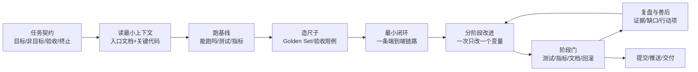
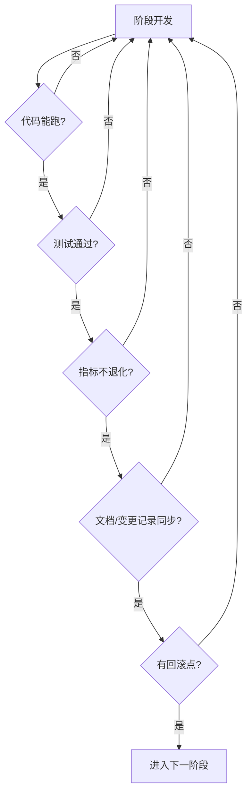
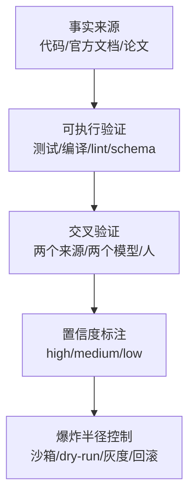

# 长时间改造的经验与方法论

> 读者：人类工程师 + AI 编码 Agent。
> 适用场景：跨多轮、多阶段、多文件的改造任务（本文以 2026-10-23～24 的 RAG 改造为实盘案例）。
> 使用方式：把它当“工作方法”，不要当“项目事实”。项目事实以代码、配置和 `docs/ARCHITECTURE.md` 为准。
> 公开资料的态度：文末列出来源，并逐条做了适用性评估；不把厂商博客、社区文章当成绝对真理。

---

## 0. 先给结论：一条主线



一句话：**先定义“什么叫完成”，再定义“怎么证明”，最后才动手改。**

---

## 1. 怎么开始：前 30 分钟做什么

### 1.1 先写“任务契约”，不要先写代码

开工前用 5 行字写清楚：

```text
目标：把 RAG 从“检索+总结”改造成“可编排的证据检索子 Agent”
非目标：不做多租户、不做文件上传 UI、不换生产向量库
验收：契约字段齐全；Golden Set 指标不低于基线；测试通过；文档同步
终止：上下文耗尽 / 全部阶段完成 / 出现不可恢复的阻塞
边界：不删除 Git 历史；不提交 .env；不把运行产物写进仓库
```

这份契约决定了后面所有“要不要做”的判断。没有它，长任务一定会跑偏。

### 1.2 只读“入口文档”，不要一上来读全仓库

推荐顺序：

1. `AGENTS.md` / `CLAUDE.md` / `README.md`：项目怎么跑、AI 该怎么读；
2. `docs/PROJECT_OVERVIEW.md`：一页纸全局；
3. `docs/ARCHITECTURE.md` 的目标章节：按索引读，不整份加载；
4. 目标模块的源码：用 grep/glob 定位，再读片段；
5. `CHANGELOG.md`：最近改了什么、为什么改。

本次 RAG 改造就是按这个顺序：先读 `AGENTS.md` 和 `PROJECT_OVERVIEW`，再读 `ARCHITECTURE` 第 7、12 节，最后才看 `rag/` 源码。

### 1.3 先跑一次基线，不要假设“现在能跑”

至少确认：

- 依赖能安装、虚拟环境能启动；
- 关键命令能跑（测试、构建、入库、评测）；
- 外部服务能连（模型、数据库、向量库）；
- 现有测试是绿还是红；
- 现有指标是多少（哪怕是 0）。

本次第一步不是改代码，而是确认 `python-docx` 没装、`pytest` 没装、`dashscope` 版本是 1.27.5、rerank 模型能不能调通。这些事实直接决定了后面的技术选择。

### 1.4 建 TODO + 备忘文件

- TODO 用于“短期执行”：阶段、状态、下一步；
- 备忘文件用于“长期记忆”：决策、已知缺口、事故、指标快照。

本次的备忘文件是 `docs/rag-improvement/00-进度备忘录.md`，结构：

```text
0. 总目标
1. 阶段状态表（待办/进行中/完成）
2. 每阶段必须同步的文档
3. 关键决策（为什么选 A 不选 B）
4. 已知限制 / 后续待办
5. 反思记录（每阶段追加）
```

**关键原则**：聊天记录是临时状态，备忘文件才是持久状态。上下文被压缩后，先读备忘文件恢复现场。

### 1.5 如果任务涉及“效果”，先造评估尺

没有评估尺就改检索/模型/提示词，等于闭眼调参。最小评估尺包括：

- 一小批固定问题（Golden Set）；
- 每题的“正确证据”标注；
- 一个离线指标脚本；
- 一个可归档的 baseline 快照。

本次在做任何检索改造前，先建了 71 条 Golden Set 和 `eval/retrieval_metrics.py`。后面每一次“混合检索有没有用”“rerank 有没有用”都由它回答。

### 1.6 先做一个“最小垂直切片”

不要一上来铺 10 个模块。先做一条端到端链路：

```text
一个文件 → 切块 → 稳定 ID → 入库 → 一次检索 → 一个结构化结果
```

链路跑通后，再逐个替换里面的零件。这样任何一步坏了，都能快速定位。

---

## 2. 中间要注意什么

### 2.1 上下文是有限资源，不是越大越好

Anthropic 的 context engineering 文章和 “Lost in the Middle” 研究都指出：

- 上下文越长，模型对中间位置信息的利用率越差；
- 上下文填满后，模型会忘记早期指令、犯更多错；
- “窗口够大”不等于“模型能用好”。

实践做法：

1. **先索引再精读**：先 `grep/glob` 找位置，只读相关片段；
2. **工具输出裁剪**：长日志只留关键段落；大文件只读行区间；
3. **阶段小结**：每完成一个子任务，用 3-5 行写“做了什么/结论/下一步”，替换掉冗长过程；
4. **必要时开新会话**：同一问题纠正两次以上，清空上下文，用更精确的提示重开；
5. **持久化状态**：把“当前事实”写进备忘文件，而不是指望模型记住。

**批判**：compaction（压缩）会丢细节，subagent 有协调成本，不能无脑用。对“必须逐字保留”的内容（契约字段、验收标准、失败日志），应显式写进文件，而不是让摘要决定去留。

### 2.2 一次只改一个变量

长任务最常见的事故是“一次改五个东西，结果不知道哪个有效”。

推荐节奏：

```text
改一个参数/模块 → 跑测试 → 跑评测 → 记录数字 → 再改下一个
```

本次的顺序是：

```text
先稳定 ID/清单 → 再混合检索 → 再 rerank → 再 Answerability → 再 Agent 接入
```

每一步都有独立可验证的产物。如果先上 rerank 再改分块，指标变化就无法归因。

### 2.3 让失败可见，不要吞异常

- 每个外部调用都要有超时、错误码、降级路径；
- 不要 `except: pass`；至少记录 warning/error；
- 结构化日志要能回答“哪一步失败、为什么、影响了谁”；
- 对外返回统一状态机（`ok/no_evidence/degraded/denied/error`），不要只返回一段“看起来正常”的文本。

本次 rerank 额度耗尽返回 403，系统没有静默失败，而是 `status=degraded`、`degraded_stages=["rerank_error"]`，并退回 RRF。这样评测能识别“这次不是正常结果”。

### 2.4 外部依赖要假设“随时会坏”

模型 API、向量库、数据库、网络都可能：

- 超时；
- 限流（429）；
- 额度耗尽（403）；
- 返回格式变化；
- 偶发 5xx。

设计原则：

1. 超时预算；
2. 有限重试（401/403 不重试）；
3. 熔断（连续失败后短时间跳过）；
4. 降级（退回可用路径）；
5. 缓存（减少重复调用）；
6. 把降级写进响应，不要假装正常。

**批判**：不要把所有失败都重试。额度耗尽、鉴权失败重试只会更慢、更贵。

### 2.5 安全和权限要“前置”，不要“事后过滤”

- ACL 必须在召回前过滤，而不是召回后再删；
- 检索到的文档、工具返回、网页内容一律视为不可信数据；
- 不可逆操作（删除、发送、下单）要人工确认或沙箱；
- 日志不记录完整 query、证据正文、密钥、PII；
- 生成答案的引用必须能在本次证据里找到。

本次的落地方式：Chroma `where` + BM25 `allowed_ids` 前置过滤；证据用 `<<<EVIDENCE ... EVIDENCE>>>` 包裹；引用用 `validate_evidence_ids` 校验；证据不足时主 Agent 强制拒答。

### 2.6 不要迷信“全自动长跑”

长任务需要停止边界：

- 最大轮数/最大步数；
- 时间预算/token 预算；
- 明确的完成条件；
- 人工检查点；
- 失败后的回滚点。

**批判**：网上有些“让 Agent 连续跑几十小时”的案例，展示的是“能推进”，不等于“产出可维护”；也有二手转述的实验观察到，Agent 可能为了 token 效率写出高度压缩、可读性差的代码。长任务的第一目标不是“跑得久”，而是“每一步可验证、可回滚”。

### 2.7 频繁检查 Git 状态

每完成一个小阶段：

```powershell
git status --short
git diff --stat
```

确认：

- 没有把 `.env`、日志、向量库、缓存提交；
- 没有误删文件；
- 改动范围符合预期；
- 需要提交的文档/测试都包含在内。

本次就遇到 `git rm --cached` 被沙箱拦截，导致“运行产物仍在索引中”。如果不在每次提交前检查，很容易把几百 MB 的 `chroma_db` 提交进去。

---

## 3. 阶段之间要注意什么：阶段门（Stage Gate）

阶段不是“做完功能就结束”，而是要通过一道门。



### 3.1 阶段门清单

| 检查项 | 问题 |
| --- | --- |
| 可运行 | 入口命令能跑通吗？ |
| 可测试 | 新增/修改有对应测试吗？测试是绿的吗？ |
| 可度量 | 指标有快照吗？和上一阶段比是升还是降？ |
| 可回滚 | 有 commit / baseline / 索引版本可以退回吗？ |
| 可解释 | 降级、失败、异常有状态码和日志吗？ |
| 可维护 | 命名、配置、文档和现有风格一致吗？ |
| 可交付 | README / ARCHITECTURE / CHANGELOG / SVG 同步了吗？ |
| 可复现 | 换一台机器，按文档能跑起来吗？ |

### 3.2 阶段之间要“对齐接口”，不要“各做各的”

上一阶段的输出就是下一阶段的输入。要明确：

- 字段名、类型、含义；
- 状态机与错误码；
- 超时/重试/降级语义；
- 版本号（`index_version`、`contract_version`）；
- 兼容策略（旧接口保留多久）。

本次的契约 `evidence[] / answerable / status / degraded_stages` 是阶段 1 定死的；阶段 2/3 只是往里填内容，没有反复改字段。这让评测、Agent 工具和文档可以并行推进。

### 3.3 阶段之间要保留“可回滚点”

- 每个阶段至少一个 commit；
- 评测 baseline 单独保存，不被降级结果覆盖；
- 索引有 `index_version`，重建前记录旧版本；
- 配置变更前备份旧值；
- 数据库/向量库变更前有备份或可重建方案。

本次的 `baseline.json` 还加了一个保护：full 模式降级率 ≥50% 时，`--save-baseline` 拒绝覆盖。这是“回滚点”思路在数据上的体现。

### 3.4 阶段划分不是越细越好

- 太细：管理开销大，每步都在写文档；
- 太粗：一次改太多，出问题无法定位。

经验：**一个阶段应该能用一个“可验证的句子”描述完成标准**。例如：

- “同一文件重复入库不会产生重复块”；
- “删除文档后，块、父块、清单一起消失”；
- “混合检索的 Recall@10 不低于 dense 基线”。

如果一句话说不清，说明阶段还太大。

---

## 4. 每个阶段结尾怎么反思和善后

### 4.1 复盘四问

每个阶段结束，回答四个问题：

1. **做了什么？**（一句话）
2. **证据是什么？**（命令、输出、指标、commit）
3. **哪里还不完善？**（已知缺口，不要美化）
4. **下一步是什么？**（具体动作，不是“继续优化”）

本次阶段 2 的例子：

```text
做了什么：Dense + BM25 + RRF + rerank
证据：dense R@10 0.6718 → hybrid 0.7041 → full 0.7439；
      MRR 0.4819 → 0.5962 → 0.6786；37 条测试通过
不完善：查询改写缺失；BM25 内存态；rerank 额度不可控
下一步：用 Golden Set 验证 query rewrite；生产期换 Qdrant/BGE-M3 sparse
```

### 4.2 善后清单

| 类别 | 动作 |
| --- | --- |
| 临时文件 | 删除 `_tmp_*.py`、调试脚本、临时数据 |
| TODO | 完成项打勾；新增风险写回待办 |
| 备忘 | 更新阶段状态、决策、指标、事故 |
| 文档 | README / ARCHITECTURE / SVG / 分阶段讲解 |
| 变更记录 | `CHANGELOG.md` 的 `[Unreleased]` |
| Git | `git status` 检查；只提交该提交的 |
| 敏感信息 | 确认 `.env`、密钥、内部文档没进版本库 |
| 运行产物 | `chroma_db/`、`storage/`、`logs/` 是否被误提交 |
| 可复现 | 按 README 从头跑一次关键命令 |
| 指标 | baseline 是否更新；旧 baseline 是否保留 |

### 4.3 反思要区分三类东西

1. **已知缺口**：明确没做，知道为什么；
2. **未知风险**：怀疑但没验证，需要下一步实验；
3. **有意不做**：非目标，明确不投入。

不要把三类混成一句“后续优化”，否则下一轮无法判断优先级。

### 4.4 事故复盘用“无指责”格式

如果阶段中出了事故（数据丢失、指标暴跌、线上故障），用 blameless postmortem：

```text
摘要：发生了什么，影响范围，恢复时间
时间线：什么时候发现、做了什么、什么时候恢复
根因：系统为什么允许这件事发生（不是“谁犯了错”）
行动项：具体任务 + 负责人 + 截止时间 + 验证方法
```

复盘实践里有一条共识：**模糊的行动项等于没有行动项**。每条行动项必须能验证。

**批判**：不要把复盘写成“工作汇报”。没有行动项、没有验证方法的复盘，只是存档。

### 4.5 本次的真实反思（示例）

- **做得好的**：先建评估尺；契约先行；确定性 ID；熔断降级；保留 baseline；37 条测试；文档同步。
- **不完善的**：Golden Set 规模不足；没有 holdout；没有双人标注 κ；没有 CI；ACL 只是接口形态；软删除/GC 未实现。
- **踩过的坑**：rerank 免费额度耗尽；HNSW 重建导致指标变化；`python-docx` 未安装；PowerShell 引号解析；`git rm --cached` 被沙箱拦截。
- **下一步**：query rewrite、CI 门禁、生产级 sparse、真实 ACL、tokenizer 分块。

---

## 5. 提高工作效率的办法

### 5.1 TODO + 备忘：两层状态管理

| 层 | 载体 | 内容 | 更新时机 |
| --- | --- | --- | --- |
| 短期 | TODO 列表 | 当前阶段、下一步、阻塞 | 开始/完成/阻塞时 |
| 长期 | `00-进度备忘录.md` | 目标、决策、指标、缺口、事故 | 每阶段结束 |

AI 特别容易“上下文一压缩就忘记做到哪”。把状态写进文件，比反复在对话里提醒更可靠。

### 5.2 读-写-验循环

```text
读最小上下文 → 改一个小点 → 跑验证 → 记录证据 → 再读下一段
```

不要：

```text
读整个仓库 → 一次改 20 个文件 → 最后跑一次测试 → 失败后不知道从哪查
```

### 5.3 什么该搜索，什么不该搜索

**应该搜索：**

- 外部 API 的签名、参数、返回格式；
- 标准/规范/论文里的指标定义；
- 错误码、限流、鉴权、安全实践；
- 依赖包的版本兼容性；
- 评测方法、数据集构建规范。

**不应该搜索：**

- 项目内部的实现事实（读代码）；
- 简单的语法/语言特性（读官方文档或直接验证）；
- 已经在本仓库文档里写清楚的内容。

### 5.4 搜索后的批判性评估

看到一条经验，至少问五个问题：

1. **发布时间/版本**：是不是针对旧版本？
2. **适用场景**：和我的规模、语言、部署形态一样吗？
3. **证据强度**：是官方文档、论文、基准测试，还是个人博客？
4. **利益立场**：厂商是否在推销自己的产品？
5. **反例**：有没有人报告失败/边界条件？

**不要把“搜索结果”直接当“事实”。** 搜索结果只是候选假设，最终要用自己的代码/测试/数据验证。

### 5.5 用“可执行验证”替代“记忆”

| 想确认的事 | 不要用 | 应该用 |
| --- | --- | --- |
| API 是否存在 | 模型记忆 | `inspect.signature` / 官方文档 / 试调用 |
| 代码是否可运行 | 看起来对 | 编译/测试/运行 |
| 指标是否变好 | 感觉 | Golden Set + baseline |
| 配置是否生效 | 猜 | 打印配置/日志/接口返回 |
| 包是否真实存在 | 模型推荐 | PyPI/npm 官方源 + 版本校验 |
| 答案是否有依据 | 语气肯定 | 引用到文件/URL/证据 ID |

本次的 `dashscope.TextReRank.call` 签名、`gte-rerank-v2` / `qwen3-rerank` / `qwen3-vl-rerank` 模型名，都是先用 `inspect.signature` 和一次真实调用确认的，不是靠记忆。

### 5.6 让 AI 自己验证，但不要让它自己打分

- 给它一个 **pass/fail 检查**：测试、构建、lint、schema、Golden Set；
- 要求它**展示证据**：命令、输出、截图、指标；
- 高风险改动用**第二个 Agent 或人**复核；
- 不要让执行者给自己的结果打分（LLM-as-judge 有偏差）。

Claude Code 的最佳实践也强调：没有可运行的检查，“看起来完成”就是唯一的完成信号，你就成了验证循环。

### 5.7 上下文与成本控制

- 先 grep/glob 定位，再读片段；
- 长输出裁剪，只保留关键行；
- 阶段总结替换过程；
- 重复查询用缓存；
- 评测分 smoke（少量样本）和 full（全量）；
- 机械改动批量做，判断性改动交互做；
- 外部 API 调用做批处理/限流，避免额度耗尽。

### 5.8 批量 vs 交互

| 任务类型 | 建议方式 |
| --- | --- |
| 重命名、格式化、批量替换 | 批量脚本/一次完成 |
| 架构选择、接口契约、安全策略 | 交互式，先计划后执行 |
| 高风险删除/迁移 | 先 dry-run，再人工确认 |
| 长任务 | 分阶段 + 检查点 + 可回滚 |

---

## 6. 如何避免幻觉

### 6.1 幻觉的几种类型

| 类型 | 例子 | 防线 |
| --- | --- | --- |
| 事实幻觉 | 编造不存在的政策/数字 | 权威来源 + 引用 |
| 引用幻觉 | 编造论文/链接/书名 | 逐条核验 URL/DOI |
| API 幻觉 | 编造不存在的方法/参数 | 官方文档 + `inspect` + 试调用 |
| 包幻觉 | 推荐不存在的包（slopsquatting） | PyPI/npm 官方源 + 供应链校验 |
| 状态幻觉 | 以为已经改过/测试过 | 读文件 + 跑命令 + 看 Git diff |
| 评测幻觉 | 用降级结果当正常结果 | 记录 `degraded_stages`；baseline 保护 |

### 6.2 五道防线



1. **事实来源**：能引用到文件、行、URL、证据 ID；
2. **可执行验证**：测试、编译、lint、schema、Golden Set；
3. **交叉验证**：两个独立来源，或第二个人/Agent；
4. **置信度标注**：不确定就写“未验证/推测”，不要用肯定语气；
5. **爆炸半径控制**：沙箱、dry-run、灰度、可回滚、人工确认。

### 6.3 编码 Agent 的具体规则

- 不猜项目结构：先 grep/glob/read；
- 不猜 API：查签名/类型/官方文档；
- 不猜版本：读 `pyproject.toml` / lockfile / 运行时版本；
- 不伪造测试结果：运行并贴输出；
- 不把“模型记得”当事实：日期、默认值、限制条件必须查；
- 不安装来路不明的包：先确认包名、作者、下载量、依赖；
- 不声称“已完成”：给出 diff、测试、命令输出、截图；
- 不确定就标注“未验证”，并给出验证步骤。

### 6.4 RAG 场景的具体规则

- 检索指标和生成指标分开；
- 负样本（不可回答）必须占一定比例；
- 证据不足时返回 `answerable=false`，不要让模型硬编；
- 引用必须来自本次检索结果；
- LLM-as-judge 只作为近似，必须人工校准（如 Cohen's κ）；
- 评测结果要记录 `index_version` 和 `degraded_stages`，降级结果不能当基线。

### 6.5 批判：不要相信“零幻觉”

- 没有任何模型/框架能保证零幻觉；
- 另一个 LLM 不能单独裁决高风险事实；
- 语气肯定不代表正确；
- “长上下文”不能替代检索和验证；
- 最可靠的是**确定性系统裁决**：测试、schema、数据库、人工复核。

---

## 7. 一套可复用的工作流模板

### 7.1 阶段划分

| 阶段 | 目标 | 典型产物 | 退出条件 |
| --- | --- | --- | --- |
| 0. 契约与基线 | 知道要做什么、现在在哪 | 任务契约、TODO、备忘、baseline | 目标/非目标/验收/终止明确 |
| 1. 最小闭环 | 端到端能跑 | 一条可运行链路、最小测试 | 命令能跑通 |
| 2. 质量提升 | 指标变好 | 评估脚本、对比报告 | 指标不低于基线 |
| 3. 工程化 | 能观测、能降级、能安全运行 | 契约、trace、熔断、权限 | 失败可见、可回滚 |
| 4. 接入与交付 | 被主流程使用 | 工具/接口、文档、CHANGELOG | 验收清单全绿 |

### 7.2 每阶段固定动作

```text
开始：更新 TODO → 读备忘 → 确认上一阶段接口
中间：一次一个变量 → 小步验证 → 记录证据
结束：跑测试/评测 → 写反思 → 清理 → 同步文档 → 提交 → 更新备忘
```

### 7.3 一页速查

| 时点 | 必做 |
| --- | --- |
| 开始前 | 写契约、读入口文档、跑基线、建 TODO/备忘 |
| 改代码前 | grep/glob 定位、读相关片段、确认接口 |
| 每次改动 | 一次一个变量、跑验证、记录证据 |
| 阶段结束 | 测试/指标/文档/回滚点/清理/反思 |
| 提交前 | `git status`、敏感信息、运行产物、CHANGELOG |
| 出事故 | 无指责复盘、根因、行动项、验证方法 |
| 不确定时 | 标注置信度、查权威来源、做实验 |

---

## 8. 本次 RAG 改造的实盘对照

### 8.1 有效的做法

1. **先评估后改系统**：没有 Golden Set，就没有 0.6718 → 0.7041 → 0.7439 这条证据链；
2. **契约先行**：`evidence[] / answerable / status` 让后续评测、Agent 接入、文档可以并行；
3. **确定性 ID**：`doc_id + version + seq` 让标注可复用、更新可传播；
4. **熔断与降级**：rerank 额度耗尽时系统仍可用，且状态可见；
5. **baseline 保护**：降级结果不覆盖正常基线；
6. **代码级拒答护栏**：不依赖模型“自觉遵守提示词”；
7. **文档同步**：README / ARCHITECTURE / SVG / CHANGELOG / 分阶段讲解。

### 8.2 踩过的坑

| 坑 | 现象 | 处理 |
| --- | --- | --- |
| `python-docx` 未安装 | 无法读 docx | 用 `zipfile + XML` 解析，不新增依赖 |
| PowerShell 引号 | 内联 Python 报语法错 | 写临时脚本，避免复杂转义 |
| rerank 免费额度耗尽 | HTTP 403 | 403 不重试；熔断；降级 RRF；保留 baseline |
| HNSW 重建 | 同一 query 的 Top-K 变化 | 记录 `index_version`；固定索引快照再对比 |
| 单字符片段 | `κ` 无法解析 | 修正 resolver：单个非汉字字符允许匹配 |
| 沙箱拦截 `git rm --cached` | 运行产物仍在 Git 索引 | 记录为已知缺口，给出手动命令，不谎称完成 |
| 测试数量写错 | 文档写 30，实际 35 | 以 `unittest` 输出为准，回头修正文档 |

### 8.3 数据结果

| 模式 | Recall@10 | MRR@10 | NDCG@10 |
| --- | --- | --- | --- |
| dense（旧） | 0.6718 | 0.4819 | 0.4862 |
| hybrid | 0.7041 | 0.5962 | 0.5752 |
| full | 0.7439 | 0.6786 | 0.6547 |

结论：混合检索的 MRR 提升 23.7%，rerank 再提升 13.8%。这些数字比“感觉好多了”更有说服力。

### 8.4 还没做的

- Golden Set 扩容 + holdout + 双人标注 κ；
- CI 门禁；
- 查询改写；
- 软删除/GC；
- 真实 ACL/多租户；
- tokenizer 分块；
- 生产级 sparse（Qdrant/BGE-M3）；
- 可观测平台（Langfuse/Phoenix）。

---

## 9. 给 AI Agent 的操作清单（可直接复制）

### 9.1 开始前

- [ ] 读 `AGENTS.md` / `PROJECT_OVERVIEW` / 目标章节，不整份读仓库；
- [ ] 写任务契约：目标、非目标、验收、终止、边界；
- [ ] 建 TODO 与进度备忘文件；
- [ ] 跑一次基线：依赖、命令、测试、指标；
- [ ] 确认外部依赖：密钥、网络、额度、版本；
- [ ] 如果涉及效果，先建最小 Golden Set；
- [ ] 先做一个端到端最小切片；
- [ ] 确认回滚点（commit / baseline / 备份）。

### 9.2 每个阶段

- [ ] 一次只改一个变量；
- [ ] 改前 grep/glob 定位，不猜项目结构；
- [ ] 外部 API 查签名/官方文档，不猜参数；
- [ ] 失败路径有超时、错误码、降级、日志；
- [ ] 高风险操作 dry-run / 人工确认；
- [ ] 记录证据：命令、输出、指标、截图；
- [ ] 不伪造“已完成”；
- [ ] 阶段门：可运行、可测试、可度量、可回滚、可解释、可维护。

### 9.3 结束前

- [ ] 跑全量测试/评测；
- [ ] 写复盘四问；
- [ ] 更新备忘：状态、决策、指标、缺口、事故；
- [ ] 清理临时文件；
- [ ] 同步 README / ARCHITECTURE / SVG / CHANGELOG；
- [ ] 检查 `git status`：敏感信息、运行产物、误删；
- [ ] 提交并记录 commit hash；
- [ ] 更新 TODO 和下一阶段入口。

### 9.4 避免幻觉

- [ ] 事实引用到文件/行/URL/证据 ID；
- [ ] API 查签名/官方文档；
- [ ] 包查官方源，防范 slopsquatting；
- [ ] 测试结果贴输出，不口述；
- [ ] 不确定标注“未验证”，给验证步骤；
- [ ] 高风险结论交叉验证；
- [ ] 降级结果不当基线；
- [ ] 不用另一个 LLM 单独裁决高风险事实。

---

## 10. 对网上经验的批判性评估

### 10.1 来源与适用性

| 来源 | 有用的部分 | 局限/批判 |
| --- | --- | --- |
| Anthropic《Effective context engineering for AI agents》 | 上下文是有限注意力预算；compaction、结构化笔记、subagent 三种长任务策略；工具要精简 | 厂商视角；compaction 会丢细节；subagent 有协调成本；不是所有任务都需要 |
| Claude Code 最佳实践 | “给它一个可运行的检查”；探索→计划→实现→提交；context 管理；对抗性复核 | 工具/产品特定；`/clear`、`/goal`、hooks 等不通用；不能照搬参数 |
| OpenAI《A practical guide to building AI agents》 | guardrails、human-in-the-loop、评测与监控 | 厂商视角；具体实现依赖其 SDK；原则可借鉴，细节要验证 |
| Google SRE Postmortem Culture | 无指责复盘；时间线、根因、行动项；行动项要跟踪闭环 | 源自运维；软件改造可借用格式，但“影响范围/恢复时间”需要改写 |
| Scrum/敏捷 DoD | “完成”要有可验证标准；测试、文档、评审都算完成 | 过度清单会适得其反；小团队要裁剪，不能为了清单而清单 |
| Lost in the Middle（Liu et al.） | 长上下文中部信息利用率下降；不能盲目塞更多上下文 | 任务/模型/benchmark 特定；不能推导出“所有长上下文都不可用” |
| RAGAS / Faithfulness | 生成侧忠实度、上下文召回等指标；负样本与拒答 | LLM-as-judge 有噪声；必须人工校准；指标不是 ground truth |
| Slopsquatting（Trend Micro 等） | AI 可能编造包名，攻击者抢注；要验证包来源 | 安全威胁真实存在；但具体攻击面随生态变化，需持续更新 |
| 中文社区/博客 | 本地工具链、PowerShell、DashScope 额度等实战细节 | 质量参差；版本/环境可能不同；必须用官方文档和实验交叉验证 |

### 10.2 哪些经验可以直接用

- 先定义完成标准，再动手；
- 先跑基线，再改；
- 一次一个变量；
- 给 Agent 可运行的检查；
- 把状态写进文件；
- 失败可见、可降级、可回滚；
- 高风险改动人工复核；
- 复盘要落到行动项。

### 10.3 哪些要谨慎

- “上下文越大越好”：错，有效上下文更重要；
- “多 Agent 一定比单 Agent 好”：不一定，协调成本可能更高；
- “全自动长跑”：高风险，必须有停止条件和检查点；
- “LLM-as-judge 可以替代人工”：不行，尤其高风险事实；
- “某个框架/模型是标准答案”：不存在，只有适合当前约束的方案；
- “社区高赞就是对的”：要看版本、场景、证据。

### 10.4 一句话

> 把网上的经验当**假设**，用自己的代码、测试、指标去**证伪**。能复现的才叫经验，不能复现的只是故事。

---

## 11. 参考资料

> 访问日期：2026-10-24。以下仅列出本文实际参考或核对过的资料；厂商文档有立场，论文有边界，博客有版本风险。

1. Anthropic, *Effective context engineering for AI agents*：<https://www.anthropic.com/engineering/effective-context-engineering-for-ai-agents>
2. Claude Code Docs, *Best practices*：<https://code.claude.com/docs/en/best-practices>
3. OpenAI, *A practical guide to building AI agents*：<https://openai.com/business/guides-and-resources/a-practical-guide-to-building-ai-agents/>
4. Google SRE Book, *Postmortem Culture: Learning from Failure*：<https://sre.google/sre-book/postmortem-culture/>
5. Liu et al., *Lost in the Middle: How Language Models Use Long Contexts*（TACL 2023）：<https://arxiv.org/abs/2307.03172>
6. Scrum Guide / Definition of Done 相关资料（如 Plane 的 DoD 指南）：<https://plane.so/blog/definition-of-done-dod-checklist-examples-for-agile-teams>
7. RAGAS 文档（Faithfulness / Context Recall 等指标）：<https://docs.ragas.io/>
8. Trend Micro, *Slopsquatting: When AI Agents Hallucinate Malicious Packages*：<https://www.trendmicro.com/vinfo/hk/security/news/cybercrime-and-digital-threats/slopsquatting-when-ai-agents-hallucinate-malicious-packages>
9. 本项目实盘：`docs/rag-improvement/00-进度备忘录.md`、`01`～`05`、`eval/results/baseline.json`、`CHANGELOG.md`

---

## 12. 最后的提醒

长任务真正的难点不是“写代码”，而是：

1. **知道自己在哪**（状态）；
2. **知道什么叫完成**（验收）；
3. **知道有没有变好**（评估）；
4. **知道坏了怎么退**（回滚）；
5. **知道哪些是猜的**（置信度）。

把这五件事做好，AI 才能从“看起来很忙”变成“每一步都可验证地推进”。
