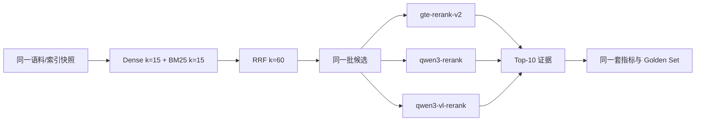

# Rerank 模型对比报告：qwen3-rerank vs qwen3-vl-rerank vs gte-rerank-v2

> 日期：2026-10-24
> 语料：`agent_v2`（论语 + 需求文档，239 子块）与 `agent_dd`（两版《道德经》，1543 子块）
> 目标：在**同一索引、同一 Golden Set、同一检索链路**下，只替换 rerank 模型，比较检索排序质量、延迟、分数校准与失败模式。
> 结论先行：**qwen3-rerank 是当前默认首选；qwen3-vl-rerank 排序质量略高但更慢，且分数不能用于 Answerability 阈值；gte-rerank-v2 在本轮数据上明显落后。**

---

## 1. 摘要

| 结论 | 说明 |
| --- | --- |
| 两个新模型都可用 | 直接改 `config/rag.yml` 的 `rerank_model_name` 即可，DashScope `TextReRank` 接口兼容 |
| qwen3-rerank 最均衡 | 论语集 R@10 0.8061、MRR 0.7722、NDCG 0.7437；平均 433ms |
| qwen3-vl-rerank 排序更细但更慢 | 论语集 MRR 0.7993、NDCG 0.7667，略高于 qwen3；平均 622ms |
| 旧 gte-rerank-v2 落后 | 论语集 R@10 0.7439、MRR 0.6786；比 qwen3 低约 6.2/9.4 个百分点 |
| 道德经集上 qwen3 召回更好 | R@10 0.5506 vs VL 0.5208；VL 的 MRR 更高（0.5429 vs 0.4899） |
| 分数校准差异很大 | gte/qwen3 的分数还能勉强做阈值；**qwen3-vl 的分数无法在 precision≥0.9 下做拒答阈值** |
| 结论 | 排序质量 ≠ 可回答性校准；生产上继续用 LLM Answerability，不要跨模型套阈值 |

**落地状态**：`config/rag.yml` 已切换为 `qwen3-rerank`，并按 qwen3 的分数分布重设 Answerability 阈值（0.40 / 0.40 / 0.85 / 0.40）；`gte-rerank-v2` 的 0.7439 baseline 保留为历史参考。

---

## 2. 实验设计

### 2.1 控制变量



固定：

- 分块参数：子块 240 / overlap 40，父块 900；
- Dense `k=15`、Sparse `k=15`、RRF `k=60`；
- `top_k=10`，rerank 返回 10 条；
- `answerability_mode=threshold`（阈值 0），**不调用 qwen-flash**，把变量隔离在“排序”上；
- 同一批 Golden Set、同一套 `resolve_snippets` 标注。

变化：

- 只改 `rerank_model_name`。

### 2.2 语料 A：`agent_v2`（论语 + 需求文档）

| 项目 | 值 |
| --- | --- |
| 集合 | `agent_v2` |
| 子块 / 父块 | 239 / 96 |
| Golden Set | 71 条：identifier 19、semantic 22、multi_condition 10、multi_hop 8、unanswerable 12 |
| 随机 Recall@10 | 0.0866 |

### 2.3 语料 B：`agent_dd`（两版《道德经》）

| 项目 | 值 |
| --- | --- |
| 集合 | `agent_dd` |
| 文件 | `《道德经》带讲解.pdf`（817 子块）、`道德经讲义(黄元吉).pdf`（726 子块） |
| 子块 / 父块 | 1543 / 450 |
| Golden Set | 32 条：identifier 6、semantic 14、multi_condition 4、multi_hop 4、unanswerable 4 |
| 随机 Recall@10 | 0.0195 |
| 标注策略 | 片段归一化匹配；`min_chunk_chars=80` 过滤目录/标题碎片；两版重复内容允许命中任一版本 |

> 道德经集是**困难集**：两版书内容高度重复，且带大量讲解，同一个原文句子会出现在多个块里。因此绝对指标偏低是正常的，重点看**同一模型相对基线的增量**。

---

## 3. 结果 A：论语 + 需求文档（71 条）

| 模型 | R@10 | Hit@10 | MRR@10 | NDCG@10 | 平均延迟 | P95 延迟 | 降级率 |
| --- | --- | --- | --- | --- | --- | --- | --- |
| Hybrid（无 rerank） | 0.7041 | 0.8305 | 0.5962 | 0.5752 | 222 ms | 406 ms | 0 |
| gte-rerank-v2 | 0.7439 | 0.8644 | 0.6786 | 0.6547 | 704 ms\* | 916 ms\* | 0 |
| **qwen3-rerank** | **0.8061** | **0.8983** | 0.7722 | 0.7437 | **433 ms** | **568 ms** | 0 |
| **qwen3-vl-rerank** | 0.8059 | 0.8983 | **0.7993** | **0.7667** | 622 ms | 907 ms | 0 |

\* gte 那次跑了 LLM Answerability，延迟包含 qwen-flash 调用；qwen3/VL 两次用 threshold 模式，不含 LLM。**延迟只在 qwen3 与 VL 之间可比**。

### 3.1 相对提升

| 对比 | R@10 | MRR@10 | NDCG@10 |
| --- | --- | --- | --- |
| Hybrid → qwen3 | +10.2 pt（+14.5%） | +17.6 pt（+29.5%） | +16.9 pt（+29.3%） |
| Hybrid → qwen3-vl | +10.2 pt（+14.5%） | +20.3 pt（+34.1%） | +19.2 pt（+33.3%） |
| gte → qwen3 | +6.2 pt（+8.4%） | +9.4 pt（+13.8%） | +8.9 pt（+13.6%） |
| gte → qwen3-vl | +6.2 pt（+8.3%） | +12.1 pt（+17.8%） | +11.2 pt（+17.1%） |
| qwen3 → qwen3-vl | -0.02 pt（噪声） | +2.7 pt（+3.5%） | +2.3 pt（+3.1%） |

### 3.2 分桶

| 类型 | Hybrid R / MRR | gte R / MRR | qwen3 R / MRR | qwen3-vl R / MRR |
| --- | --- | --- | --- | --- |
| identifier（19） | 0.929 / 0.813 | 0.949 / 0.927 | 0.955 / 0.929 | **0.959 / 0.929** |
| semantic（22） | 0.685 / 0.428 | 0.699 / 0.546 | 0.761 / 0.720 | **0.761 / 0.788** |
| multi_condition（10） | 0.583 / 0.681 | 0.650 / 0.668 | **0.817 / 0.823** | 0.808 / **0.850** |
| multi_hop（8） | 0.375 / 0.438 | 0.500 / 0.469 | **0.563 / 0.483** | **0.563 / 0.460** |

读法：

- identifier 桶：三者都很好，qwen3 系列略高；
- semantic 桶：qwen3 系列提升最大，VL 的 MRR 更好；
- multi_condition 桶：qwen3 系列大幅提升（0.68 → 0.82）；
- multi_hop 桶：qwen3 的 Recall 更好；VL 的 MRR 反而略低，说明“多跳”仍是短板。

---

## 4. 结果 B：道德经（32 条）

| 模型 | R@10 | Hit@10 | MRR@10 | NDCG@10 | 平均延迟 | P95 延迟 |
| --- | --- | --- | --- | --- | --- | --- |
| Hybrid | 0.4420 | 0.7143 | 0.4230 | 0.3663 | 337 ms | 517 ms |
| **qwen3-rerank** | **0.5506** | **0.7500** | 0.4899 | 0.4626 | **554 ms** | **591 ms** |
| qwen3-vl-rerank | 0.5208 | 0.7500 | **0.5429** | 0.4633 | 714 ms | 779 ms |

### 4.1 相对提升

- Hybrid → qwen3：R +10.9 pt（+24.6%），MRR +6.7 pt（+15.8%），NDCG +9.6 pt（+26.3%）；
- Hybrid → qwen3-vl：R +7.9 pt（+17.8%），MRR +12.0 pt（+28.3%），NDCG +9.7 pt（+26.5%）；
- qwen3 → qwen3-vl：R -3.0 pt，MRR +5.3 pt，NDCG 基本持平，延迟 +29%。

### 4.2 分桶

| 类型 | Hybrid R / MRR | qwen3 R / MRR | qwen3-vl R / MRR |
| --- | --- | --- | --- |
| identifier（6） | 0.822 / 0.653 | **0.878 / 1.000** | **0.878 / 0.917** |
| semantic（14） | 0.255 / 0.300 | 0.362 / 0.320 | **0.386 / 0.431** |
| multi_condition（4） | **0.385 / 0.271** | 0.354 / 0.175 | 0.354 / 0.292 |
| multi_hop（4） | 0.583 / 0.661 | **0.917 / 0.633** | 0.625 / 0.625 |

读法：

- 道德经的 semantic 桶整体很低（原文+讲解+两版重复，召回困难），rerank 能提升，但仍不到 0.4；
- qwen3 在 multi_hop 上明显更好（0.917 vs 0.625）；
- VL 在 semantic MRR 上更好（0.431 vs 0.320）；
- multi_condition 两者都略低于 Hybrid，说明“多条件+古汉语”仍是硬骨头。

---

## 5. 逐 query 胜负

以“第一个相关块的倒数排名（RR）”比较，候选相对 Hybrid：

| 对比 | 胜 / 负 / 平 | top-1 命中 + / - | 平均 RR 增量 |
| --- | --- | --- | --- |
| gte vs Hybrid（71） | 17 / 5 / 49 | +9 / -2 | +0.0684 |
| qwen3 vs Hybrid（71） | 22 / 5 / 44 | +16 / -3 | +0.1463 |
| qwen3-vl vs Hybrid（71） | 20 / 5 / 46 | +17 / -2 | +0.1688 |
| qwen3 vs Hybrid（32） | 9 / 5 / 18 | +5 / -2 | +0.0586 |
| qwen3-vl vs Hybrid（32） | 11 / 3 / 18 | +7 / -3 | +0.1049 |

### 5.1 典型提升

- `ly-019`「听其言而观其行」：qwen3 把 RR 从 0.17 提到 1.00；
- `ly-002`「曾子每天反省自己哪些方面」：0.17 → 1.00；
- `rq-006`「生产期推荐的可观测方案」：0.17 → 1.00；
- `dd-024`「为学日益/为道日损」：0.50 → 1.00；
- `dd-013`「祸兮福之所倚」：VL 从 0.25 提到 1.00。

### 5.2 典型退化（以及为什么不能全怪模型）

- `ly-028`「君子和小人在待人接物上有哪些不同？」：Hybrid RR 1.00，qwen3 降到 0.12。
  - 检查发现 qwen3 的 top-1 是「君子不可小知，而可大受也；小人不可大受，而可小知也」，也是君子/小人对比，但不在我们标注的 3 个片段里。
  - 这是**标注覆盖不足**：同一个问题有多种有效答案，严格按 3 个片段算，model 会被误判。
- `rq-015`「parent_id 字段的用途」：Hybrid RR 1.00，rerank 降到 0.50。
  - qwen3 top-1 是数据模型表格里 `parent_id | 父块标识，用于父子扩展`，其实也是正确答案，只是没被标注进 relevant。
- `dd-027`「黄元吉认为治大国若烹小鲜的关键」：VL 从 1.00 降到 0.20。
  - 可能是 VL 更偏向原文/通用讲解，而不是特定注家；这属于**版本/注家敏感**。

结论：逐 query 胜负能看趋势，但**严格 chunk 标注会低估 rerank**；上线前应做人工抽检，或把“答案正确性”作为补充指标。

---

## 6. Rerank 分数与 Answerability 校准

### 6.1 分数分布（论语集，top-1 rerank 分数）

| 模型 | 可回答 min / median / max | 不可回答 min / max | 阈值扫描结果 |
| --- | --- | --- | --- |
| gte-rerank-v2 | 0.154 / 0.196 / 0.832 | 0.138 / 0.173 | 阈值 0.14 时只能拒 1/12，precision 1.0 |
| qwen3-rerank | 0.450 / 0.770 / 0.983 | 0.387 / 0.632 | 阈值 0.39 时只能拒 1/12，precision 1.0 |
| qwen3-vl-rerank | 0.682 / 0.828 / 0.951 | 0.611 / 0.732 | **在 precision≥0.9 下没有可行阈值** |

### 6.2 结论

1. **排序最好的模型，不一定分数最可校准**。VL 的 MRR/NDCG 最好，但可回答/不可回答分数几乎完全重叠。
2. 三个模型的分数尺度不同，**不能把 gte 的 0.35/0.60/0.10 直接套到 qwen3 或 VL 上**。
3. 生产上继续用 `qwen-flash` 的 LLM Answerability；rerank 分数只作为参考特征，不作为唯一拒答依据。
4. 如果一定要用阈值，必须用**目标模型自己的 Golden Set**重新校准，并接受“只能拒掉一小部分负样本”的现实。

---

## 7. 为什么两个新模型会不一样？

| 维度 | qwen3-rerank | qwen3-vl-rerank |
| --- | --- | --- |
| 模型定位 | 纯文本 rerank | 视觉-语言 rerank（文本也能用） |
| 论语集 R@10 | 0.8061 | 0.8059（几乎相同） |
| 论语集 MRR | 0.7722 | **0.7993** |
| 道德经 R@10 | **0.5506** | 0.5208 |
| 道德经 MRR | 0.4899 | **0.5429** |
| 延迟 | **433 ms** | 622 ms |
| 分数校准 | 可做很有限的阈值 | 不可做阈值 |
| 适用 | 默认通用 RAG、成本敏感 | 排序质量优先、延迟可接受、Answerability 用 LLM |

可能原因：

- VL 模型训练目标包含图文对齐，对“文本相关性”的排序更细，但分数尺度更“平”，不利于阈值；
- VL 可能更偏向通用/原文语义，对特定注家（黄元吉）的匹配不如纯文本模型；
- 模型越大/多模态，延迟越高。

> 以上是行为观察，不是模型内部机制结论；不要把“为什么”当成已证实的因果。

---

## 8. 道德经：当训练集还是数据集？

**当评测集，不当训练集。**

原因：

1. 两个模型都是 DashScope 托管 API，项目没有微调能力；
2. 把《道德经》当训练集需要标注问答对、微调/蒸馏，成本远高于收益；
3. 它更适合做**第二评测语料**：
   - 古汉语、长文本、两版重复、带讲解，能暴露“版本混淆/注家混淆”；
   - 和论语同属古典文本，可以观察 rerank 是否真的理解古文，而不是只会匹配现代词；
   - 两版并存天然构成“hard negative”：同一句话在两个版本里都有，模型要能区分“原文”和“讲解”。

本次用法：

- 两份 PDF 单独建 `agent_dd` 集合，不污染 `agent_v2`；
- 32 条 Golden Set，覆盖原文、注家、多跳、负样本；
- `min_chunk_chars=80` 过滤目录/标题碎片；
- 两版重复内容允许命中任一版本。

后续可以：

- 扩充到 50-100 条；
- 增加“只问黄元吉注”的版本区分题；
- 用同一批 query 测 query rewrite（现代词 → 古汉语）。

---

## 9. 建议

### 9.1 默认选型

**默认 `qwen3-rerank`。**

理由：

- 论语集 R@10 最高（0.8061），与 VL 几乎相同；
- 延迟比 VL 低约 30%-44%；
- 道德经集 Recall 更好（0.5506 vs 0.5208）；
- 分数虽然也不能单独做拒答，但至少还能做有限校准。

### 9.2 什么时候用 qwen3-vl-rerank

- 你更看重 MRR/NDCG（第一条是否最相关），而不是 Recall；
- 延迟预算能接受 600-900ms；
- Answerability 继续用 LLM judge，不依赖它的分数；
- 语料以现代文本/图文混合为主，而不是特定注家。

### 9.3 配置改法

本次已把默认配置切换为 `qwen3-rerank`：

```yaml
# config/rag.yml
rerank_model_name: qwen3-rerank
answerability_threshold: 0.40
answerability_fallback_threshold: 0.40
answerability_high_threshold: 0.85
answerability_low_threshold: 0.40
```

如需切回或切到 VL：

```yaml
rerank_model_name: gte-rerank-v2
# 或
# rerank_model_name: qwen3-vl-rerank
```

注意：

- 换模型后**不要直接沿用** `answerability_high_threshold / low_threshold / fallback_threshold`；
- 建议先跑 `eval.run_eval --modes full --answerability-mode llm` 重跑 Answerability；
- VL 的 P95 接近 907ms，`rerank_timeout_ms: 3000` 仍够，但如果网络抖动可调到 5000；
- 熔断阈值 3 次/120 秒保持不变。

### 9.4 下一步

1. 用 50-100 条更大 Golden Set 复测，做 bootstrap 置信区间；
2. 给 `ly-028`、`rq-015` 这类“多有效答案”的题补充标注，减少低估；
3. 测 `qwen3-rerank + LLM Answerability` 的端到端拒答指标；
4. 比较“rerank 子块” vs “rerank 父块”；
5. 如果成本敏感，测 `rerank_candidate_k=15`（只精排前 15 个融合候选），看能否保住指标、降低调用成本。

---

## 10. 复现命令

```powershell
# A. 论语 + 需求文档（agent_v2）
.venv\Scripts\python.exe -m eval.run_eval --modes hybrid --top-k 10 `
  --answerability-mode threshold --tag v2-hybrid-current

.venv\Scripts\python.exe -m eval.run_eval --modes full --top-k 10 `
  --rerank-model qwen3-rerank --answerability-mode threshold --tag rerank-qwen3

.venv\Scripts\python.exe -m eval.run_eval --modes full --top-k 10 `
  --rerank-model qwen3-vl-rerank --answerability-mode threshold --tag rerank-qwen3vl

# B. 道德经（agent_dd）
.venv\Scripts\python.exe -m rag.vector_store --rebuild `
  --collection agent_dd `
  --index-manifest storage/index_manifest_dd.json `
  --parent-store storage/parents_dd.json `
  --include-keywords 道德经

.venv\Scripts\python.exe -m eval.run_eval --modes hybrid --top-k 10 `
  --collection agent_dd --index-manifest storage/index_manifest_dd.json `
  --parent-store storage/parents_dd.json --golden eval/golden_set_daodejing.jsonl `
  --answerability-mode threshold --tag dd-hybrid-v3

.venv\Scripts\python.exe -m eval.run_eval --modes full --top-k 10 `
  --collection agent_dd --index-manifest storage/index_manifest_dd.json `
  --parent-store storage/parents_dd.json --golden eval/golden_set_daodejing.jsonl `
  --rerank-model qwen3-rerank --answerability-mode threshold --tag dd-qwen3

.venv\Scripts\python.exe -m eval.run_eval --modes full --top-k 10 `
  --collection agent_dd --index-manifest storage/index_manifest_dd.json `
  --parent-store storage/parents_dd.json --golden eval/golden_set_daodejing.jsonl `
  --rerank-model qwen3-vl-rerank --answerability-mode threshold --tag dd-qwen3vl

# 对比报告
.venv\Scripts\python.exe -m eval.compare_reports `
  --baseline hybrid=eval/results/eval-20261024-153111-v2-hybrid-current.json `
  --candidate gte=eval/results/eval-20261023-225811.json `
  --candidate qwen3=eval/results/eval-20261024-153048-rerank-qwen3.json `
  --candidate qwen3vl=eval/results/eval-20261024-153204-rerank-qwen3vl.json `
  --out eval/results/rerank-comparison-v2.json
```

---

## 11. 局限与批判

1. **样本量小**：71 + 32 条，71 条里的 1-2 个百分点可能是噪声。qwen3 与 VL 的 R@10 只差 0.0002，不能据此说“qwen3 更好”；只能说“排序质量相近”。
2. **标注覆盖不足**：`ly-028`、`rq-015` 的“退化”其实是标注没覆盖所有有效答案；严格 chunk 指标会低估 rerank。
3. **道德经集更难**：两版重复 + 讲解，绝对 Recall 低；只适合做相对比较，不适合对外承诺“0.55 就是好”。
4. **延迟不完全可比**：gte 那次带 LLM Answerability，qwen3/VL 用 threshold；只有 qwen3 vs VL 的延迟可比。
5. **索引快照**：gte 结果来自 2026-10-23，qwen3 结果来自 2026-10-24；hybrid 复跑仍是 0.7041，说明影响很小，但 Chroma HNSW 是近似检索，严格实验应固定索引快照。
6. **未测端到端 Answerability**：本轮只测排序；LLM judge 的行为没有随模型重跑。
7. **未做统计显著性检验**：没有 bootstrap/配对置信区间；结论是“方向性”的，不是“统计显著”的。
8. **额度风险**：本轮约 206 次 rerank 调用；免费额度随时可能耗尽。代码已有熔断降级，但报告数据是在额度正常时采集的。

---

## 12. 一句话

> 在本次语料上，**qwen3-rerank 是性价比最高的默认选择**；**qwen3-vl-rerank 排序更细但更慢、分数不可用于拒答**；旧 gte-rerank-v2 已被明显超越。换模型可以，但必须重跑 Golden Set、重新校准阈值，并且记住：**排序指标和可回答性指标不是一回事。**
